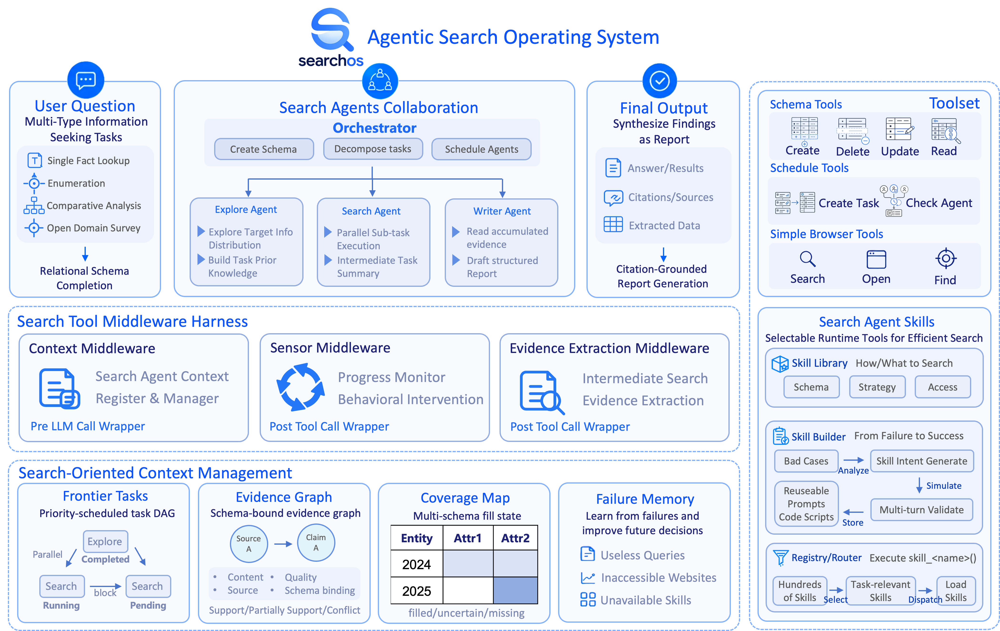
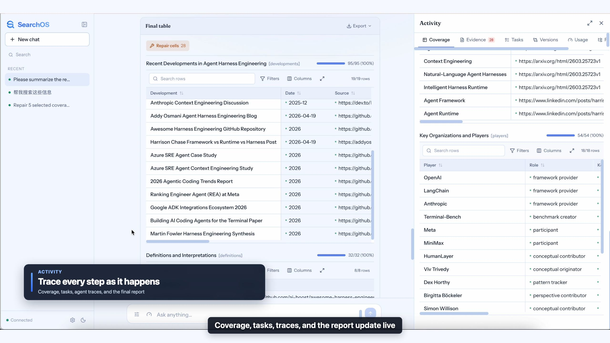
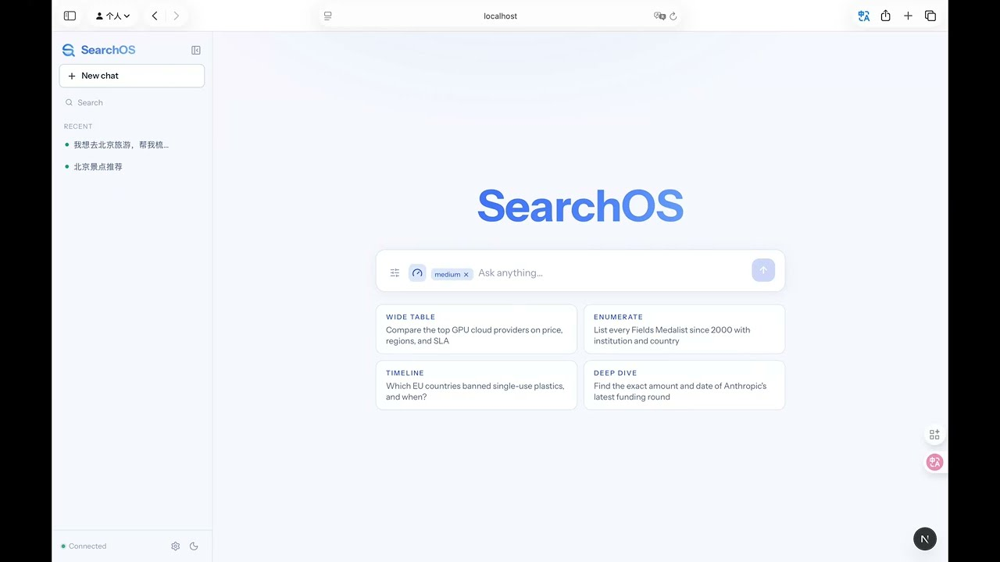
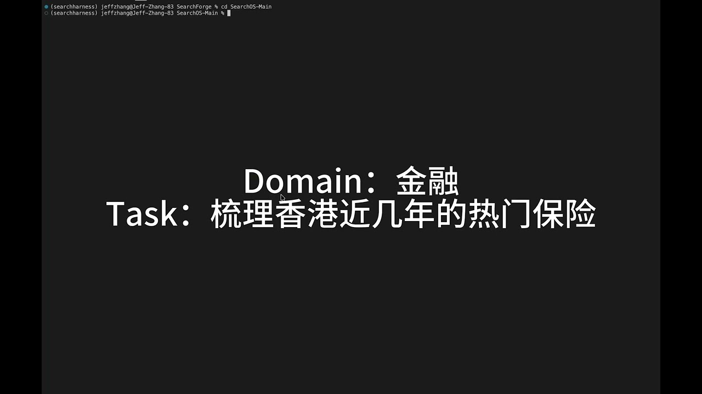
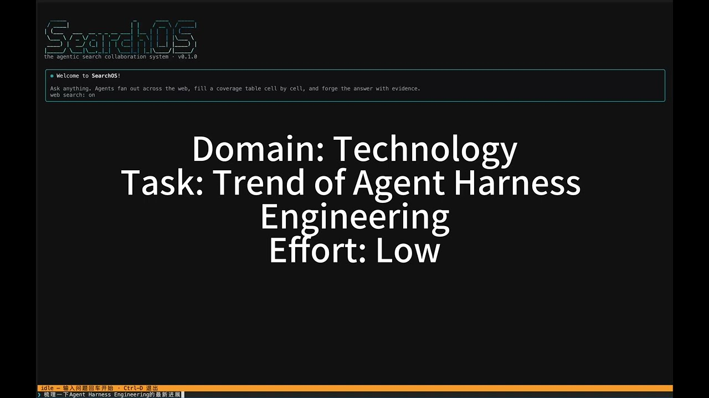
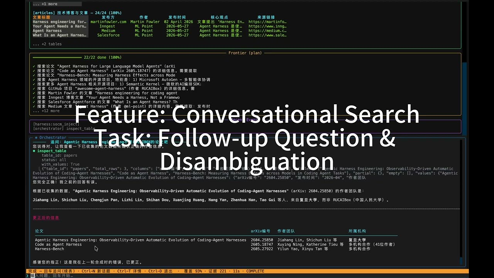
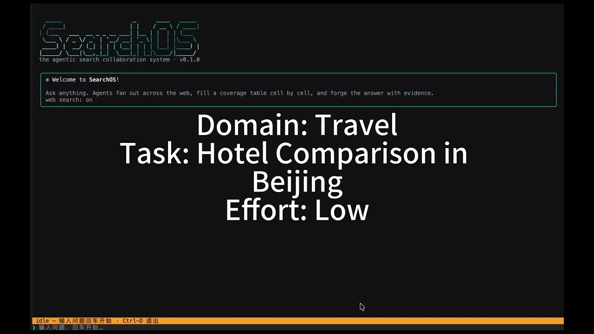
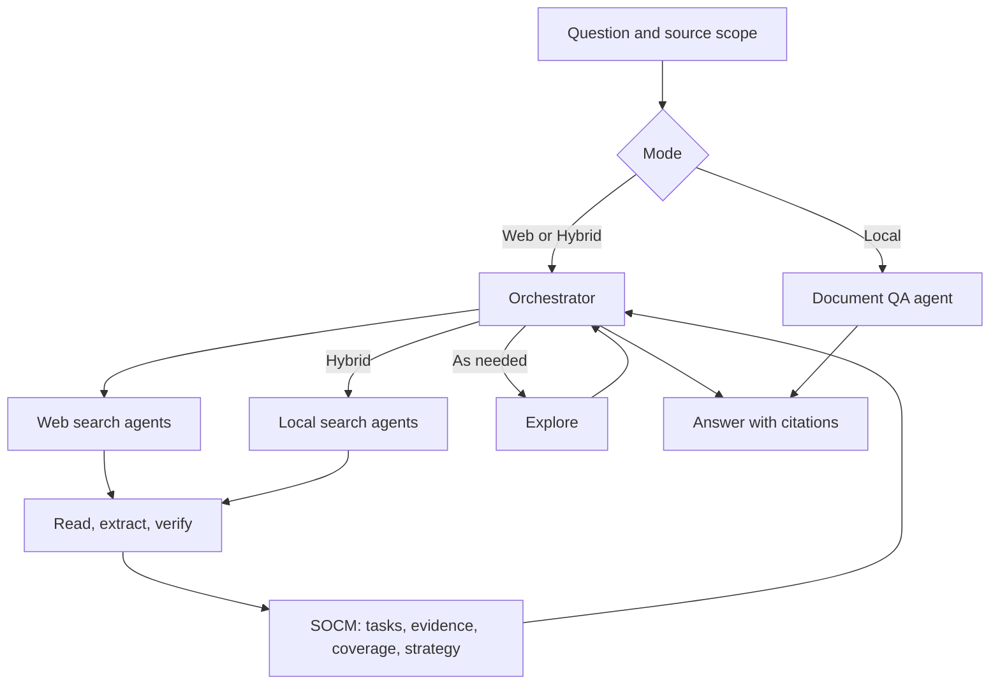

<div align="center">

[中文](docs/README.zh.md) | **English** | [日本語](docs/README.ja.md) | [한국어](docs/README.ko.md)

</div>

<p align="center">
  
</p>

<h3 align="center">A multi-agent research workspace for the Web and your documents</h3>

<p align="center">
  <a href="https://antins-labs.github.io/SearchOS/"></a>
  <a href="https://arxiv.org/abs/2607.15257"></a>
  <a href="https://huggingface.co/papers/2607.15257"></a>
  <a href="https://www.youtube.com/watch?v=DZNXxMcxnMQ&amp;list=PLXMUs3Ayz3EQ"></a>
  <a href="https://www.python.org/"></a>
  <a href="https://github.com/langchain-ai/langgraph"></a>
  <a href="https://github.com/Textualize/textual"></a>
  <a href="LICENSE"></a>
</p>

<p align="center">
  SearchOS coordinates agents to research the Web and your local documents, saves facts with their sources,
  and organizes findings into comparison tables and reports when useful.
  Build a knowledge library, refine a running investigation, and turn source access methods and research strategies into reusable skills.
</p>

<p align="center">
  <a href="#-quick-start">Quick start</a> · <a href="#-local-and-hybrid-research">Local &amp; Hybrid</a> ·
  <a href="#-skill-system">Skills</a> · <a href="#-configuration">Models &amp; configuration</a> ·
  <a href="#-framework">Architecture</a> · <a href="#-gallery">Demos</a> · <a href="#-evaluation">Evaluation</a>
</p>

<p align="center">
  
</p>

<p align="center"><sub>SearchOS-V1 architecture.</sub></p>

<p align="center">
  <a href="https://youtu.be/DZNXxMcxnMQ">
    
  </a>
</p>

<p align="center">
  🎬 <b><a href="https://youtu.be/DZNXxMcxnMQ">Full demo video (YouTube)</a></b>
</p>

<p align="center">
  <a href="https://youtu.be/wxy74AqykwY" title="Watch the narrated SearchOS product walkthrough in English">
    
  </a>
</p>

<p align="center">
  🎬 <b><a href="https://youtu.be/wxy74AqykwY">Full product walkthrough (English)</a></b>
</p>

## ✨ Highlights

- 📚 **Research your own documents** — import PDFs, Office files, Markdown, spreadsheets, and images. Browse topics and documents in a list or graph, ask about selected files or an entire library, and follow citations back to the original material.
- 🌐 **Combine local and Web sources** — choose Web, Local, or Hybrid. In Hybrid, the Orchestrator delegates to local and Web agents according to the question and combines their evidence in one answer.
- 🔗 **Keep useful sources and findings** — save Web sources to your library, revisit cited passages, and extend existing evidence and tables through follow-up questions.
- 🧰 **Create and reuse skills** — start from a website, task, or execution trace; inspect creation progress and installed packages in the Web UI. Portable packages use `SKILL.md` and ordinary CLI scripts.
- 💬 **Steer research while it runs** — add a constraint, correct the scope, or ask for a final answer. A follow-up wakes a waiting Orchestrator without waiting for a sub-agent to finish.
- 🗂️ **Inspect shared research state** — SOCM keeps tasks, evidence, coverage, and strategy in persistent state. Agents work against explicit gaps, while budget and progress checks help contain stalled work.
- 🧩 **Research against explicit coverage gaps** — entity × attribute tables record sourced values and missing fields. The Orchestrator uses these gaps to direct follow-up retrieval within the available budget.
- ⚡ **Run research tasks in parallel** — independent agents overlap searching, reading, and evidence collection; task dependencies determine which work is ready to dispatch.

> 📊 **SearchOS-V1** led the reported F1 metrics on **WideSearch / GISA**, including **GISA Set · F1 +13.4 points** over the next-best baseline. See [Evaluation](#-evaluation) for the original results and their scope.

## 📣 News

- **2026-10-12** — **Portable Skills.** The skill system now uses `SKILL.md` packages and standalone CLI scripts. Create skills from websites, tasks, or execution traces, then export them for reuse in compatible agent harnesses with the required dependencies and execution permissions.
- **2026-09-29** — **Composable Middleware.** Context management, evidence extraction, and budget and progress monitoring are now independently composable components, with default pipelines for different agent tasks and optional context compaction. See the [middleware guide](docs/middleware-composition.md).
- **2026-09-15** — **Knowledge Library.** Organize documents and saved Web sources by topic, browse them in list or graph views, and ask questions across selected files or an entire library.
- **2026-09-14** — **Multimodal Search.** Extend source reading to images and scanned documents, using multimodal models to retrieve information beyond the text layer.
- **2026-09-13** — **Hybrid Search.** Coordinate local document reading and Web retrieval in one research workflow, combining their evidence into answers and comparison tables.
- **2026-09-10** — **Local Search.** Search your own documents and read relevant passages to answer questions from local source material.
- **2026-07-17** — **SearchOS-V1 on arXiv.** Read the paper on [arXiv](https://arxiv.org/abs/2607.15257) or [Hugging Face](https://huggingface.co/papers/2607.15257).
- **2026-07-11** — **Start faster. Search wider. See every step.** A new one-command installer gets SearchOS running; parallel Explore waves scout the web in batches, while live progress and evidence grouped by entity make every discovery easier to follow. Skills now run in hardened, isolated workers. ⚡
- **2026-07-10** — **A whole new way to research.** Draw the structure of your question. SearchOS turns it into citation-backed research you can explore, refine, and export. 🧩
- **2026-07-09** — **Pick up exactly where you left off.** Every session returns with its conversation, progress, evidence, and live activity intact. ⏪
- **2026-07-08** — **Everything in one place.** Models, providers, search, skills, and budgets now come together in one beautifully simple control center. ⚙️
- **2026-07-07** — **SearchOS is open source.** Multi-agent search, structured research, TUI, and Web UI.

## 🎥 Gallery

### Local Search introduction

<p align="center">
  <a href="https://youtu.be/l9vEq6SdvZA">
    
  </a>
</p>

<p align="center">
  <a href="https://youtu.be/l9vEq6SdvZA"><b>Watch the Local Search introduction on YouTube</b></a>
</p>

The recordings below demonstrate Web and TUI workflows.

### Web and TUI demos

<table align="center">
  <tr>
    <td width="50%" align="center">
      <a href="https://youtu.be/dfzu9aeK0Cs" title="SearchOS-Web Demo · Watch on YouTube">
        
      </a>
      <sub>▶️ <b>SearchOS-Web Demo</b></sub>
    </td>
    <td width="50%" align="center">
      <a href="https://youtu.be/bS07neJm6FA" title="SearchOS-Web Demo 2 · Watch on YouTube">
        
      </a>
      <sub>▶️ <b>SearchOS-Web Demo 2</b></sub>
    </td>
  </tr>
  <tr>
    <td width="50%" align="center">
      <a href="https://youtu.be/YhJdc7Qhr1U" title="SearchOS-demo1 · Watch on YouTube">
        
      </a>
      <sub>▶️ <b>SearchOS-demo1</b></sub>
    </td>
    <td width="50%" align="center">
      <a href="https://youtu.be/IA_-sO2avTA" title="SearchOS-demo3 · Watch on YouTube">
        
      </a>
      <sub>▶️ <b>SearchOS-demo2</b></sub>
    </td>
  </tr>
  <tr>
    <td width="50%" align="center">
      <a href="https://youtu.be/HxCLoauXoYg" title="SearchOS-demo4 · Watch on YouTube">
        
      </a>
      <sub>▶️ <b>SearchOS-demo3</b></sub>
    </td>
    <td width="50%" align="center">
      <a href="https://youtu.be/-QmjRr_3B1s" title="SearchOS-demo5 · Watch on YouTube">
        
      </a>
      <br><sub>▶️ <b>SearchOS-demo4</b></sub>
    </td>
  </tr>
</table>

<p align="center"><sub>Click a cover to watch on YouTube.</sub></p>

<!-- To add a video: copy a <td>…</td> block above and swap the youtu.be link, assets/gallery thumbnail, and title -->

## 🧭 Quick start

**Personal cloud deployment + iPhone:** see [the self-hosting guide (中文)](docs/zh/self-hosting.md)
for the Docker Compose source-build deployment, HTTPS, device pairing, notifications,
backup and recovery. This requires a version containing `deploy/`; prebuilt official images
are not published by this change.

Requires **Python ≥ 3.11** and **Node.js ≥ 20.9** for the Web frontend. From the repository root:

```bash
./install.sh
source .venv/bin/activate
python -m pip install -e ".[local-docs]"
searchos --setup
./web/start.sh
```

The installer prepares Python, bundled Access Skill dependencies, Chromium, and the Web frontend. The additional `local-docs` step installs document parsers and PDF rendering dependencies. The setup wizard configures a model provider and API key; configure a search provider in Settings before using Web or Hybrid research.

Open [the Web workspace](http://localhost:3000). The API runs on port `8000`. In Settings, connect your providers, add model configurations, and assign their uses. Image and scan reading needs a model that accepts image input.

### Try a research workflow

1. Open **Knowledge library**, create a library, and upload a few papers. Once their text is parsed, you can ask questions while summaries and topic indexing continue in the background.
2. Choose **Local**, select the papers, and ask: “Compare these papers' methods and evaluation settings, with references to the original passages.”
3. Choose **Hybrid** and ask: “Find related public work and compare it with these papers.” Select the same documents to keep the local scope explicit.
4. During the Hybrid run, add: “Focus on methods evaluated on real tasks,” or “Stop collecting sources and summarize the evidence so far.”
5. Open a citation to inspect its source. Save useful Web sources to the library for future research.

CLI and TUI remain available:

For example, run a structured Web query from the terminal:

```bash
searchos "Top-5 universities per subject in the 2025 QS rankings, with application deadlines"
```

| Command | What it does |
| --- | --- |
| `python -m searchos "<query>"` | Run a Web query; report at `searchos_workspace/<timestamp>/output/report.md` |
| `python -m searchos` | Open the TUI for Web research, live steering, follow-ups, and session management |
| `python -m eval.run --benchmark widesearch --range 1-50` | Run evaluations; install the `eval` extra first |

Use the Web workspace for knowledge-library management and Web/Local/Hybrid source selection.

## 📚 Local and Hybrid research

### Choose the source scope

| Mode | Sources | Typical use |
| --- | --- | --- |
| **Web** | Online sources | Research public information and compare entities across sources |
| **Local** | Selected documents, or the current library when no documents are selected | Read papers, compare reports, or locate information in your files |
| **Hybrid** | Authorized local documents or library, plus the Web | Resolve a reference in your files, verify external information, or extend a local review |

Local runs use a document QA agent directly. Hybrid runs use the Orchestrator to plan local and Web work; the question determines which sources are needed and whether work can proceed in parallel. Selecting a library allows discovery within its readable documents at submission time; selecting files narrows that scope. Other libraries are outside the run's local scope.

### Build and navigate a library

Supported formats include **PDF, DOCX, PPTX, XLSX, Markdown, TXT, CSV, TSV, JSON, JSONL, HTML**, and common image formats. The library organizes content into **topics → documents → sections**, with summaries for navigation. A document can belong to multiple topics; you can adjust its memberships in the list or graph view.

You can rename libraries and documents, create or edit topics, and delete items from the library panel. Deleting a topic keeps its documents; deleting a document or library removes its sources and makes their historical citations unavailable. See the [local knowledge and search guide](docs/local-search-feature-introduction-zh.md) for the architecture, management APIs, and walkthroughs.

The agent uses the catalog to locate material, searches within relevant sections, and reads original passages as needed. Summaries guide navigation; citations rely on the original material actually read. Depending on the file type, a citation can identify a page, slide, line, or spreadsheet region. See the [document indexing design](docs/local-document-recap.md) for parsing and summary details.

Web source entries can be saved to an existing library and indexed for later questions. Follow-up research can reuse committed evidence and saved reading windows, then extend tables or collect additional facts when the question changes.

### Read images and scanned pages

Local parsing supports visual reading for scanned documents and images. For online sources, enable **image reading** in Search settings to let agents inspect image URLs and individual PDF pages. Auto mode chooses between direct image input and the configured vision model; Settings includes a separate image-input check.

## 💬 Follow-ups and live steering

Web/Hybrid runs in the browser and research sessions in the TUI accept input during execution. If the Orchestrator is waiting for sub-agents, your follow-up wakes it and triggers a model call with the new request. Active sub-agents keep running until the Orchestrator decides whether to continue or stop them. If a model call or another tool is already executing, the input is applied at the next complete tool boundary.

After a run, follow-ups reuse the session's evidence and tables. The Orchestrator can answer from existing findings or schedule work for remaining gaps. Pure Local questions use their own document QA flow.

### Interactive TUI

`python -m searchos` opens the full-screen interface: a live dashboard on top (task dispatch, sub-agent status, coverage map growth) and the tool stream below. The input box supports new queries, live steering, and follow-ups:

| When | What typing natural language does |
| --- | --- |
| Idle | Starts a new search run |
| **Mid-run** | **Live steering** — wakes an Orchestrator waiting for sub-agents and starts its next model call with your input; use it to add constraints, change direction, or request a final answer |
| After a run | **Multi-turn follow-up** — reuses the previous round's coverage map and evidence: if the answer is already in the table it is answered directly (no new search); otherwise the existing table is extended incrementally, never rebuilt from scratch |

Slash commands are available during a run; configuration changes apply as described below:

| Command | Alias / shortcut | What it does |
| --- | --- | --- |
| `/new` | `/clear` · `Ctrl-N` | New topic: clears conversation history and the coverage map; the next question starts from a fresh workspace |
| `/resume [session-id]` | `/load` | Restore a previous session with its conversation, trajectory, coverage, and evidence; omit the id to open the picker |
| `/effort [low\|medium\|high\|max]` | — | Effort tier: adjusts iteration cap, task and tool budgets, wall-clock limit, and skill-routing top-k in one go; with no argument it opens an interactive picker; mid-run changes take effect next round |
| `/skill` | — | Skill management: no argument opens a grouped multi-select dialog; subcommands `list`, `only <names…>` (whitelist, fuzzy prefix match), `on` / `off <names…>`, `all` (reset to router control) for fine-grained control |
| `/model` | — | Open shared model settings: provider connections, model cards, model purpose assignments, and per-profile limits |
| `/search [auto\|serper\|tavily\|ragflow]` | — | Inspect or switch the shared search backend |
| `/config [key value]` | `/set` | Open the shared settings panel or quickly change supported run defaults |
| `/verbose` | `/detail` · `Ctrl-T` | Toggle compact / detailed tool stream |
| `/stop` | `/cancel` · `Esc` | Interrupt the current run (Esc exits the program when idle) |
| `/help` | `/?` | Command help |
| `/quit` | `/exit` · `Ctrl-D` | Exit SearchOS |

The four `/effort` presets apply to subsequent runs; all four set the parallel sub-agent limit to 8:

| Tier | Orchestrator iterations | Searches per agent | Wall-clock cap | Routing top-k |
| --- | :---: | :---: | :---: | :---: |
| `low` | 25 | 10 | 10 min | 20 |
| `medium` (default) | 50 | 20 | 30 min | 40 |
| `high` | 100 | 35 | 60 min | 60 |
| `max` | 150 | 50 | 120 min | 80 |

## 🧰 Skill system

Skills are reusable packages in [`searchos/skills/library/`](searchos/skills/library/):

| Category | Purpose |
| --- | --- |
| **Access** | Retrieve data from a particular source or through a specific access method |
| **Strategy** | Guide research methods such as ranking, disambiguation, and multi-hop retrieval |
| **Orchestrator** | Guide task decomposition, dependencies, dispatch, and synthesis |

### Create, update, and inspect skills

Open **Skills** in the Web sidebar to search the library and inspect instructions and implementation files. Choose **Create skill** and supply a website, a task, or an execution trace. Task and trace analysis can create new packages or update existing ones when it identifies a reusable capability gap. SearchOS generates and validates candidates before publishing them, and records the action and outcome for each package. Submitted jobs continue while you navigate elsewhere.

Validation depends on the category: Access packages run CLI examples; Strategy candidates are applied to a subtask and checked against their answer and sources; Orchestrator packages receive structural validation. Updates check the installed package version before replacement, while active tasks retain their loaded snapshots. See the [Portable Skills guide](docs/portable-skills.md) for package structure, creation and update flows, and cross-harness examples.

### Use portable packages

A package contains `SKILL.md` and, when needed, `scripts/`, `references/`, and dependency declarations. Its CLI scripts do not import SearchOS. Agents discover and load a package, execute its scripts, then read saved result pages through the same browser tools used for other sources. Reading those pages feeds evidence extraction and verification.

```bash
searchos skills validate /path/to/arxiv-search
searchos skills install /path/to/arxiv-search --library searchos/skills/library
searchos skills export /path/to/arxiv-search --output /path/to/export/arxiv-search
```

These package operations do not require a model. Running scripts requires their declared dependencies and a supported execution backend: `sandbox-exec` on macOS or `bubblewrap` on Linux. A host that cannot provide that backend reports execution as blocked. Exported packages use the destination host's own tools, dependencies, and permissions.

Runtime routing recommends skills; explicit allowlists and disabled skills constrain discovery and execution. Local document QA exposes local reading tools only. Optional post-run skill generation in **Settings → Skills** analyzes the execution trace to create or update **Access, Strategy, and Orchestrator** packages, using the model assigned to skill creation.

## ⚙️ Configuration

Configure provider connections, model profiles, search, skills, and budgets in Web Settings. The setup wizard (`searchos --setup`) and TUI commands `/model`, `/search`, and `/config` share the `web_settings.json` configuration overlay with Web runs. Secrets can also be supplied through `.env`; copy [`.env.example`](.env.example) and fill in the keys you use.

Models are assigned by **purpose**, covering agents and other model calls:

| Group | Uses |
| --- | --- |
| **Research** | Planning and coordination, search and reading, evidence extraction, review and verification |
| **Content processing** | Writing and answer fallback, document and topic summaries, images and scanned documents |
| **Skills and failure review** | Skill selection and repair planning, skill creation and repair, failure review |
| **Evaluation** | Evaluation result formatting |

**Quick assignment** lets you select general, text-processing, and vision models, preview the affected assignments, and apply them together. Individual purposes remain editable; evaluation is configured separately. Multiple purposes can share a profile. A successful text connection test does not establish image-input support.

Provider presets and environment-only configuration are documented in [providers](docs/providers.md). Common overrides include:

| Setting | Description |
| --- | --- |
| `SF_MODEL` / `SF_FAST_MODEL` | Override the preset's main / lightweight model |
| `SF_API_BASE` | Override the model endpoint |
| `SF_SEARCH_PROVIDER` | Search backend: `serper` \| `tavily` \| `ragflow` |
| `SF_BROWSER_BACKEND` | Fetch backend: `jina` \| `aiohttp` \| `crawl4ai` \| `search_engine` |
| `SF_ROLES__JUDGE=main` | Assign a profile to a model purpose; `ROLES` remains the configuration key |
| `SF_PROFILES__MAIN__RPM=60` / `SF_PROFILES__MAIN__TPM=100000` | Per-profile request/token limits; `0` disables a limit |
| `SF_MAX_PARALLEL_AGENTS` | Sub-agent concurrency cap, default `8` |
| `SF_ENABLE_EXPLORE_BATCH` / `SF_EXPLORE_MAX_WAVES` | Batch exploration and its maximum waves per call, default `3`; no minimum wave count |
| `SF_ENABLE_EXPLORE` / `SF_ENABLE_SKILLS` | Disable Explore / Skills for controlled runs |
| `SF_SKIP_SYNTHESIS` | Evaluation mode: export the coverage table without synthesis |

### Installation options

```bash
python -m pip install -e .               # core CLI/TUI and Web API
python -m pip install -e ".[access]"     # bundled Access Skill dependencies
python -m pip install -e ".[local-docs]" # local document parsers and PDF rendering
python -m pip install -e ".[eval]"       # evaluation dependencies
python -m pip install -e ".[all]"        # all optional runtime dependencies
```

`./install.sh --core` skips Access Skill and browser runtimes; `--no-web` skips frontend dependencies. `./install.sh --all --dev` includes local-document, evaluation, and development dependencies. See the [installation guide](docs/installation.md).

## 💡 Why SearchOS

Long research tasks accumulate sources, unresolved questions, and partial conclusions. If that progress is carried only in conversation history, compression can hide useful facts and later agents can repeat completed work.

SearchOS maintains tasks, evidence, coverage, and strategy in **SOCM — Search-Oriented Context Management**. Source reading feeds extraction and verification; committed facts retain their sources and can support later tasks or table cells. The Orchestrator schedules unresolved work against that state. Budget and progress monitoring help detect repeated or stalled activity, while the workspace exposes the resulting evidence and remaining gaps.

These mechanisms address four recurring problems:

- **Losing progress in conversation history.** Persistent tasks, evidence, and coverage let later work continue from recorded findings. Context middleware brings the relevant state into each agent's context; session history supports inspection and resumption.
- **Repeating completed or stalled work.** The Orchestrator tracks unresolved tasks and table cells, while Sensor middleware checks budgets and progress. These signals guide follow-up work and changes in search direction.
- **Losing sources during summarization.** Agents locate and read material; Extraction middleware extracts and verifies candidate facts before committing them with source references. Answers and table cells can then cite the supporting evidence.
- **Rebuilding access methods and research procedures.** Access, Strategy, and Orchestrator skills preserve source-specific retrieval, methods such as ranking and disambiguation, and orchestration guidance. See the [Skill system](#-skill-system).

Local libraries add persistent source material to this workflow. Their catalogs help agents locate relevant documents; Hybrid research connects those readings with public sources. Skills preserve reusable access methods and research procedures for later runs.

## 🧩 Framework



The Orchestrator selects the next action from the question and current evidence. In ordinary runs, **Explore is optional**: it resolves uncertainties about identity, scope, candidate sets, or sources, and can be dispatched again during research. The evaluation runner defaults to an initial Explore step.

**Source selection and result structure are separate decisions.** Hybrid research can collect findings before creating a table. Tables organize comparisons and expose missing cells when useful; table-bound Web search still requires a schema. Existing evidence can support additional tasks or cells without replacing the original facts.

The **Context, Sensor, and Extraction** middleware handle context assembly, budgets and progress, and evidence intake. The Orchestrator normally produces the final answer; the optional Writer and synthesis fallback support other delivery paths. Session workspaces retain state, reading records, and execution logs for follow-ups and inspection.

For structured Web or Hybrid research, the workflow has six stages. The Orchestrator can revisit them as new evidence or gaps appear:

1. **Explore** — when needed, clarify the question, locate useful sources, and identify candidate entities.
2. **Schema** — define entity tables, attributes, and relations when the task calls for structured comparison; Hybrid can collect findings before creating a table.
3. **Dispatch** — split unresolved work into subtasks and dispatch ready tasks according to priority, dependencies, and available concurrency.
4. **Extract** — turn source observations into verified facts with citations, then associate them with tasks and relevant table cells.
5. **Assess** — review results, remaining gaps, conflicts, progress, and budget to decide what needs further work.
6. **Synthesize** — assemble the answer from recorded evidence, preserve citations, and identify unresolved gaps when the run ends.

### What the output looks like

This excerpt is preserved from the July 2026 README to show how cell-level citations map to source entries. The original query asked for a survey of popular insurance products in Hong Kong; the values belong to that historical run.

```markdown
### Major insurers in Hong Kong
| Company     | English name   | 2024 APE rank | 2023 premiums  |
|-------------|----------------|---------------|----------------|
| 友邦保险     | AIA [6]        | #1 [6]        | HK$87.1B [6]   |
| 保诚         | Prudential [6] | #2 [6]        | HK$65.3B [6]   |
| 汇丰保险     | HSBC Life [6]  | #3 [6]        | HK$55.5B [6]   |
| 宏利         | Manulife [6]   | #4 [6]        | HK$49.8B [6]   |

### Sources
[6] https://www.ia.org.hk/tc/infocenter/press_releases/20250425.html, https://inews.hket.com/…
```

The full artifact (a replayable directory with the trajectory, page cache, and SOCM state) lives under `searchos_workspace/<timestamp>/`.

## 📊 Evaluation

The following results are from **SearchOS-V1**. They evaluate the original Web research system; Local/Hybrid retrieval, portable skill creation, and the latest runtime changes have not been re-benchmarked in this table.

On **WideSearch** (wide-table retrieval) and **GISA** (open-domain information seeking), compared against 2 single-agent baselines (ReAct / Plan-and-Solve) and 3 multi-agent systems (Table-as-Search / A-MapReduce / Web2BigTable). All scores are **max@3** (best of three runs per case, ×100); **bold** marks the best in each row. *Item* scores cells independently; *Row* requires a fully correct row.

| Benchmark | Metric | ReAct | Plan-and-Solve | Table-as-Search | A-MapReduce | Web2BigTable | **SearchOS** |
| --- | --- | :---: | :---: | :---: | :---: | :---: | :---: |
| WideSearch | Item · Precision | 82.9 | 83.8 | 82.4 | 83.1 | 78.3 | **83.9** |
| | Item · Recall | 70.2 | 72.9 | 73.5 | 74.2 | 73.4 | **79.7** |
| | Item · F1 | 72.9 | 75.2 | 75.4 | 76.0 | 73.8 | **80.3** |
| | Row · Precision | 58.0 | 58.7 | 57.1 | 56.9 | 57.5 | **59.0** |
| | Row · Recall | 48.8 | 50.2 | 51.6 | 49.8 | 54.0 | **55.8** |
| | Row · F1 | 50.9 | 52.2 | 52.7 | 51.4 | 54.5 | **56.5** |
| GISA | Table · Item · F1 | 74.8 | 71.2 | 73.4 | 72.5 | 68.1 | **76.9** |
| | Table · Row · F1 | 58.1 | 50.7 | 54.1 | 52.1 | 45.3 | **59.7** |
| | Set · F1 | 61.6 | 63.1 | 60.9 | 62.5 | 56.7 | **76.5** |
| | List · F1 | 67.1 | 53.8 | 54.2 | 57.4 | 65.5 | **68.1** |
| | Item · EM | 0.0 | 16.7 | 16.7 | 33.3 | **50.0** | **50.0** |

In these experiments, SearchOS-V1 leads on the reported F1 metrics across both benchmarks. On GISA enumeration tasks, Set · F1 exceeds the next-best baseline by 13.4 points.

## 🗺️ Roadmap

- [x] **SearchOS-V1 technical report** — architecture and Web research evaluation on [arXiv](https://arxiv.org/abs/2607.15257).
- [x] **Local libraries and Hybrid research** — document import, topic navigation, original-source citations, and coordinated local/Web retrieval.
- [x] **Skill creation and portable packages** — website/task/trace inputs, category-specific validation, a skill-library UI, and CLI install/export.
- [x] **Visual reading** — images, scanned documents, and individual online PDF pages.
- [ ] **Skill maintenance and broader validation** — improve long-term reliability across sources and execution environments.
- [ ] **Audio and video research** — extend retrieval and evidence support to additional modalities.
- [ ] **Broader source integrations** — academic, enterprise, and domain-specific collections.

These are current development directions, with no fixed release dates. Suggestions and contributions are welcome through GitHub Issues.

## 🗂️ Project layout

```text
searchos/
├── agents/        Orchestrator, Explore, Web Search, Local Search, and optional Writer
├── local/         Document parsers, summaries, topic catalog, source registry, and readers
├── harness/       Sessions, live steering, Context/Sensor/Extraction middleware, telemetry
├── socm/          Shared tasks, evidence, coverage, and strategy
├── tools/         Schema, tasks, browser, skills, and other agent tools
├── skills/        Portable packages, catalog, execution runtime, intent, and creation pipelines
├── tui/           Live dashboard, session management, settings, and follow-ups
├── config/        Providers, model purposes, limits, effort presets, and shared settings
└── cli.py         searchos / python -m searchos

web/api/           Runs, streaming, libraries, imports, skill creation jobs, and settings
web/frontend/      Research workspace, knowledge-library views, Skills pages, and configuration
eval/              Benchmark runners, scorers, and evaluation exports
datasets/          WideSearch and GISA data
eval_results/      Evaluation outputs
searchos_workspace/ Research session workspaces
```

## 👥 Authors

<p align="center">
  <strong>Yuyao Zhang</strong><sup>1,2,*,‡</sup> ·
  <strong>Junjie Gao</strong><sup>2,*</sup> ·
  <strong>Zhengxian Wu</strong><sup>2</sup> ·
  <strong>Jiaming Fan</strong><sup>2</sup> ·
  <strong>Jin Zhang</strong><sup>2</sup> ·
  <strong>Shihan Ma</strong><sup>2</sup> ·
  <strong>Yao Yao</strong><sup>2</sup> ·
  <strong>Weiran Qi</strong><sup>2</sup> ·
  <strong>Guiyu Ma</strong><sup>2</sup> ·
  <strong>Xingzhong Xu</strong><sup>2</sup> ·
  <strong>Kai Yang</strong><sup>2</sup> ·
  <strong>Ji-Rong Wen</strong><sup>1</sup> ·
  <strong>Zhicheng Dou</strong><sup>1,†</sup>
</p>

<p align="center"><sup>1</sup> Renmin University of China · <sup>2</sup> Ant Group</p>

## 🙏 Acknowledgements

SearchOS was developed through the joint efforts of the authors and contributors listed above. We thank Ant Insurance for its strong support throughout the project.

## 📚 Citation

If SearchOS helps your research, please cite our [paper](https://arxiv.org/abs/2607.15257):

```bibtex
@article{zhang2026searchos,
  title={SearchOS-V1: Towards Robust Open-Domain Information-Seeking Agent Collaboration},
  author={Zhang, Yuyao and Gao, Junjie and Wu, Zhengxian and Fan, Jiaming and Zhang, Jin and Ma, Shihan and Yao, Yao and Qi, Weiran and Jin, Chuyan and Ma, Guiyu and others},
  journal={arXiv preprint arXiv:2607.15257},
  year={2026}
}
```

## 📄 License

MIT — see [LICENSE](LICENSE). Additional terms about source-code comments are
described in [LEGAL.md](LEGAL.md).
