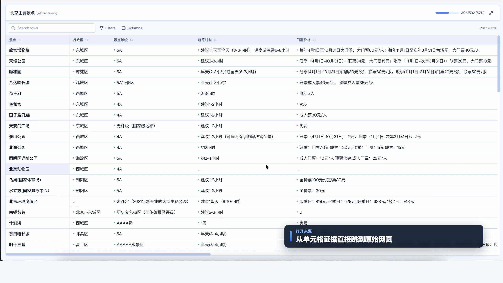
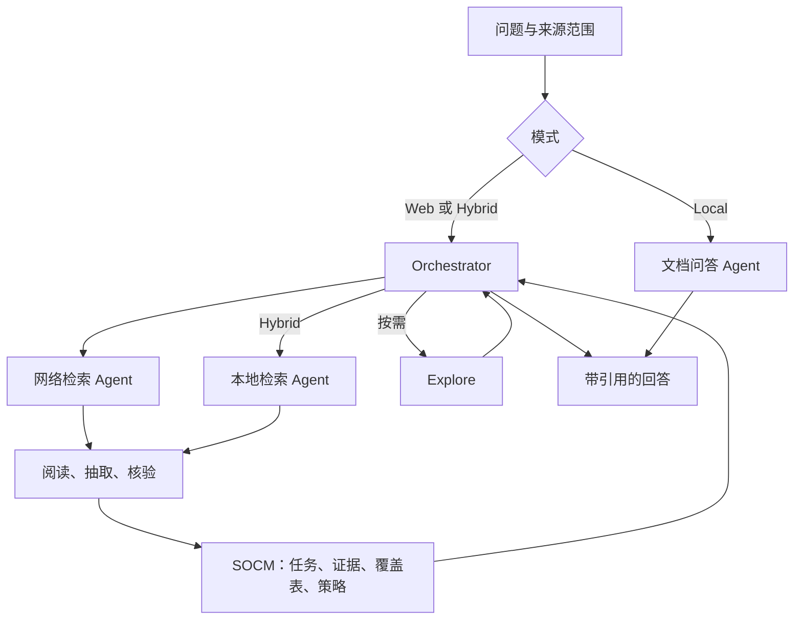

<div align="center">

**中文** | [English](../README.md) | [日本語](README.ja.md) | [한국어](README.ko.md)

</div>

<p align="center">
  
</p>

<h3 align="center">面向网络与本地资料的多智能体研究工作台</h3>

<p align="center">
  <a href="https://antins-labs.github.io/SearchOS/"></a>
  <a href="https://arxiv.org/abs/2607.15257"></a>
  <a href="https://huggingface.co/papers/2607.15257"></a>
  <a href="https://www.python.org/"></a>
  <a href="https://github.com/langchain-ai/langgraph"></a>
  <a href="https://github.com/Textualize/textual"></a>
  <a href="../LICENSE"></a>
</p>

<p align="center">
  SearchOS 按问题调度智能体检索网络与本地资料，将事实连同来源保存在共享研究状态中，
  并按需组织为比较表和研究报告。你可以导入资料建立知识库，在研究过程中补充要求，
  也可以把来源访问方法与研究策略保存为可复用技能。
</p>

<p align="center">
  <a href="#-快速上手">快速上手</a> · <a href="#-本地与混合研究">本地与混合研究</a> ·
  <a href="#-技能系统">技能系统</a> · <a href="#-配置">模型与配置</a> ·
  <a href="#-系统架构">系统架构</a> · <a href="#-gallery">演示</a> · <a href="#-评测">评测</a>
</p>

<p align="center">
  
</p>

<p align="center"><sub>SearchOS-V1 架构。</sub></p>

<p align="center">
  <a href="https://youtu.be/DZNXxMcxnMQ">
    
  </a>
</p>

<p align="center">
  🎬 <b><a href="https://youtu.be/DZNXxMcxnMQ">完整 Demo 视频（YouTube）</a></b>
</p>

<p align="center">
  <a href="https://youtu.be/WsjcDtCN0Cs" title="观看 SearchOS 中文产品讲解">
    
  </a>
</p>

<p align="center">
  🎬 <b><a href="https://youtu.be/WsjcDtCN0Cs">完整产品讲解（中文）</a></b>
</p>

## ✨ 核心能力

- 📚 **查询自己的资料**——导入 PDF、Office、Markdown、表格和图片，通过列表或图谱浏览主题与文档；可以查询指定文件或整个知识库，引用定位到原文。
- 🌐 **联合本地与网络来源**——选择 Web、Local 或 Hybrid。Hybrid 由 Orchestrator 按问题安排本地阅读与联网检索，将两类证据汇入同一回答。
- 🔗 **积累资料与研究结果**——将网络来源保存到知识库，回看已引用的原文，并通过后续追问扩展已有证据和表格。
- 🧰 **创建并复用技能**——从站点、任务或执行轨迹发起创建，在 Web 中查看生成进度和已安装技能。通用技能包使用 `SKILL.md` 与普通 CLI 脚本。
- 💬 **运行中调整研究**——补充约束、修改范围或要求收尾。追问会唤醒等待中的 Orchestrator，无需等子任务完成。
- 🗂️ **查看共享研究状态**——SOCM 持久化任务、证据、覆盖表与策略，让智能体围绕明确缺口工作，并通过预算和进展检查约束停滞任务。
- 🧩 **围绕覆盖缺口检索**——实体 × 属性表记录带来源的取值与待补字段，Orchestrator 根据这些缺口，在预算内安排后续检索。
- ⚡ **并行推进研究任务**——独立智能体的搜索、阅读与证据收集可以重叠执行，任务依赖决定哪些工作可以分派。

> 📊 **SearchOS-V1** 在 **WideSearch / GISA** 的已报告 F1 指标上领先，其中 **GISA Set · F1 比次优基线高 13.4 点**。原始结果与适用范围见[评测](#-评测)。

## 📣 更新

- **2026-10-12**——**通用技能重构（Portable Skills）。** 技能统一为 `SKILL.md` 与独立 CLI 脚本，可从站点、任务或执行轨迹创建，再导出到兼容的通用 Agent Harness 中复用，由目标环境提供所需依赖与执行权限。
- **2026-09-29**——**可组合中间件（Composable Middleware）。** 将上下文管理、证据抽取、预算与进展监测拆为可独立组合的组件，提供面向不同 Agent 任务的默认管线，并新增按需启用的上下文压缩。详见[中间件说明](middleware-composition.md)。
- **2026-09-15**——**知识库（Knowledge Library）。** 按主题组织文档与保存的网络来源，通过列表或图谱浏览资料，并对指定文件或整个知识库提问。
- **2026-09-14**——**多模态搜索（Multimodal Search）。** 将来源阅读扩展到图片与扫描文档，通过多模态模型获取文本层之外的信息。
- **2026-09-13**——**混合搜索（Hybrid Search）。** 在同一研究流程中协调本地阅读与联网检索，结合两类证据生成回答和比较表。
- **2026-09-10**——**本地搜索（Local Search）。** 检索自己的文档，按问题定位并阅读相关段落，根据本地原文回答。
- **2026-07-17**——**SearchOS-V1 论文上线 arXiv。** 前往 [arXiv](https://arxiv.org/abs/2607.15257) 或 [Hugging Face](https://huggingface.co/papers/2607.15257) 阅读。
- **2026-07-11** — **更快开始，更广搜索，全程可见。** 全新一键安装器让 SearchOS 快速就绪；并行 Explore waves 分批探索开放网络，实时进度与按实体分组的证据让每一次发现都清晰可追。Skill 现已在强化隔离的工作进程中运行。 ⚡
- **2026-07-10** — **研究，从画出结构开始。** 描绘问题，SearchOS 把它变成可探索、可完善、可导出的引用级研究成果。 🧩
- **2026-07-09** — **离开多久，都能原样回来。** 对话、进度、证据与实时动态完整保留，打开即可继续。 ⏪
- **2026-07-08** — **所有设置，一个地方。** 模型、服务商、搜索、技能与预算，汇聚在一个简单而完整的控制中心。 ⚙️
- **2026-07-07**——**SearchOS 正式开源。** 提供多智能体搜索、结构化研究、TUI 与 Web UI。

## 🎥 Gallery

### Local Search 介绍

<p align="center">
  <a href="https://youtu.be/l9vEq6SdvZA">
    
  </a>
</p>

<p align="center">
  <a href="https://youtu.be/l9vEq6SdvZA"><b>观看 Local Search 介绍视频（YouTube）</b></a>
</p>

下方展示 Web 与 TUI 的使用流程。

### Web 与 TUI 演示

<table align="center">
  <tr>
    <td width="50%" align="center">
      <a href="https://youtu.be/dfzu9aeK0Cs" title="SearchOS-Web Demo · 在 YouTube 观看">
        
      </a>
      <sub>▶️ <b>SearchOS-Web Demo</b></sub>
    </td>
    <td width="50%" align="center">
      <a href="https://youtu.be/bS07neJm6FA" title="SearchOS-Web Demo 2 · 在 YouTube 观看">
        
      </a>
      <sub>▶️ <b>SearchOS-Web Demo 2</b></sub>
    </td>
  </tr>
  <tr>
    <td width="50%" align="center">
      <a href="https://youtu.be/YhJdc7Qhr1U" title="SearchOS-demo1 · 在 YouTube 观看">
        
      </a>
      <sub>▶️ <b>SearchOS-demo1</b></sub>
    </td>
  </tr>
  <tr>
    <td width="50%" align="center">
      <a href="https://youtu.be/IA_-sO2avTA" title="SearchOS-demo3 · 在 YouTube 观看">
        
      </a>
      <sub>▶️ <b>SearchOS-demo3</b></sub>
    </td>
    <td width="50%" align="center">
      <a href="https://youtu.be/HxCLoauXoYg" title="SearchOS-demo4 · 在 YouTube 观看">
        
      </a>
      <sub>▶️ <b>SearchOS-demo4</b></sub>
    </td>
  </tr>
  <tr>
    <td colspan="2" align="center">
      <a href="https://youtu.be/-QmjRr_3B1s" title="SearchOS-demo5 · 在 YouTube 观看">
        
      </a>
      <br><sub>▶️ <b>SearchOS-demo5</b></sub>
    </td>
  </tr>
</table>

<p align="center"><sub>点击封面在 YouTube 观看。</sub></p>

<!-- 新增视频：复制上面的 <td>…</td> 块，替换 youtu.be 链接、assets/gallery 缩略图与标题即可 -->

## 🧭 快速上手

需要 **Python ≥ 3.11**；Web 前端需要 **Node.js ≥ 20.9**。在仓库根目录执行：

```bash
./install.sh
source .venv/bin/activate
python -m pip install -e ".[local-docs]"
searchos --setup
./web/start.sh
```

安装脚本准备 Python 环境、内置 Access Skill 依赖、Chromium 和 Web 前端；额外的 `local-docs` 步骤安装文档解析与 PDF 渲染依赖。配置向导用于选择模型厂商并填写密钥；使用 Web 或 Hybrid 前，还需在设置中配置搜索服务。

打开 [Web 工作台](http://localhost:3000)，API 运行在 `8000` 端口。在设置中连接模型服务、添加模型配置，再按用途分配。读取图片和扫描件需要支持图片输入的模型。

### 试一次完整研究

1. 打开侧栏的**知识库**，新建知识库并上传几篇论文。正文解析完成后即可提问，摘要与主题索引在后台继续生成。
2. 选择 **Local** 并勾选论文，提问：“比较这些论文的方法和实验设置，标出原文依据。”
3. 选择 **Hybrid**，继续提问：“检索相关公开研究，与这些论文进行比较。”勾选相同文档，明确本轮本地资料范围。
4. Hybrid 运行中补充：“只保留在真实任务上评测过的方法”，或“停止收集来源，根据已有证据总结。”
5. 点击引用检查原文，将有用的网络来源保存到知识库，供后续研究使用。

也可以使用 CLI 和 TUI：

例如，在终端发起一个结构化 Web 查询：

```bash
searchos "2025 年 QS 学科排名各学科前五的大学及其申请截止日期"
```

| 命令 | 作用 |
| --- | --- |
| `python -m searchos "<query>"` | 执行 Web 查询，报告写入 `searchos_workspace/<时间戳>/output/report.md` |
| `python -m searchos` | 打开 TUI，进行 Web 研究、运行中追问、多轮问答与会话管理 |
| `python -m eval.run --benchmark widesearch --range 1-50` | 运行评测；需先安装 `eval` 依赖组 |

知识库管理及 Web/Local/Hybrid 来源选择通过 Web 工作台使用。

## 📚 本地与混合研究

### 选择资料范围

| 模式 | 来源 | 适用场景 |
| --- | --- | --- |
| **Web** | 网络来源 | 调查公开信息，跨来源比较实体 |
| **Local** | 勾选的文档；未勾选时查询当前知识库 | 阅读论文、比较报告、查找文件中的信息 |
| **Hybrid** | 授权的本地文档或知识库，加上网络来源 | 解析文件中的指代、核验外部信息、扩展已有综述 |

Local 由文档问答 Agent 直接读取资料并回答。Hybrid 由 Orchestrator 规划本地与网络任务，根据问题决定需要哪些来源、哪些工作可以并行。选择整个知识库时，Agent 可以探索本轮提交时库内的可读文档；选择具体文件时，本地范围收窄到这些文件，其他知识库不在本轮范围内。

### 建立并浏览知识库

支持 **PDF、DOCX、PPTX、XLSX、Markdown、TXT、CSV、TSV、JSON、JSONL、HTML** 和常见图片格式。资料按**主题 → 文档 → 章节**组织，摘要帮助定位内容。一份文档可以关联多个主题，也可以在列表或图谱中手动调整归属。

知识库面板支持重命名资料库和文档、创建与编辑主题，以及删除资料。删除主题保留文档；删除文档或整个资料库会清除对应来源，使历史引用不可用。架构、管理接口与操作演示见[本地知识库与检索指南](local-search-feature-introduction-zh.md)。

Agent 先通过目录定位资料，再在相关章节查找并按需读取原文。目录摘要用于导航，回答引用以实际读取的原文为依据。根据文件类型，引用可以定位到页、幻灯片、行或表格区域。解析与摘要机制见[文档索引设计](local-document-recap.md)。

网络来源可以保存到已有知识库并建立索引。后续研究可复用已提交证据和保存的阅读窗口，再根据新问题扩展表格或收集缺失事实。

### 阅读图片与扫描件

本地解析支持对扫描文档和图片进行视觉读取。对于网络来源，在搜索设置中启用**图片阅读**后，Agent 可以查看图片链接和在线 PDF 的指定页面。自动模式会在主模型直接读图与配置的视觉模型之间选择；设置中提供独立的图片输入能力检测。

## 💬 多轮追问与运行中调整

浏览器中的 Web/Hybrid 研究与 TUI 会话支持在运行中继续输入。Orchestrator 正在等待子任务时，追问会将其唤醒，并带着新要求发起模型调用。子任务继续运行，由 Orchestrator 决定继续还是停止；如果已有模型调用或其他工具正在执行，则在下一处完整工具边界处理追问。

运行结束后的追问沿用会话中的证据与表格。Orchestrator 可以直接根据已有事实作答，也可以只派发剩余缺口。纯 Local 使用独立的文档问答流程。

### 交互式 TUI

`python -m searchos` 进入全屏界面：上方是实时 dashboard（任务分派、子智能体状态、覆盖表增长），下方是工具流。同一个输入框根据时机自动分流：

| 时机 | 输入自然语言的效果 |
| --- | --- |
| 空闲时 | 开始一次新的搜索运行 |
| **运行中** | **实时追问**——唤醒正在等待子任务的 Orchestrator，带着新要求发起下一次模型调用；可补充约束、调整方向或要求收尾 |
| 运行结束后 | **多轮追问**——沿用上一轮覆盖表与证据：答案已在表中则直接作答（不再检索），否则在现有表上增量扩展，不从零重建 |

运行中也可以使用斜杠指令；配置修改的生效时机见下表：

| 指令 | 别名 / 快捷键 | 作用 |
| --- | --- | --- |
| `/new` | `/clear` · `Ctrl-N` | 开新话题：清空对话历史与覆盖表，下一问从全新工作区开始 |
| `/resume [session-id]` | `/load` | 恢复历史会话及其对话、轨迹、覆盖表与证据；不带 id 时打开选择器 |
| `/effort [low\|medium\|high\|max]` | — | 投入档位：一次性调整迭代上限、任务与工具预算、墙钟时限、技能路由 top-k；无参数弹出交互选择器，运行中修改下一轮生效 |
| `/skill` | — | 技能管理：无参数打开分组勾选弹窗；子命令 `list`（列出）、`only <名字…>`（白名单，前缀模糊匹配）、`on` / `off <名字…>`（启停）、`all`（重置交回路由）精细控制启用集 |
| `/model` | — | 打开共享模型设置：Provider 连接、模型卡、模型用途分配与 profile 限速 |
| `/search [auto\|serper\|tavily\|ragflow]` | — | 查看或切换共享搜索后端 |
| `/config [key value]` | `/set` | 打开共享设置面板，或快速修改支持的运行默认值 |
| `/verbose` | `/detail` · `Ctrl-T` | 切换精简 / 详细工具流 |
| `/stop` | `/cancel` · `Esc` | 中断当前运行（空闲时 Esc 退出程序） |
| `/help` | `/?` | 指令帮助 |
| `/quit` | `/exit` · `Ctrl-D` | 退出 SearchOS |

`/effort` 四档预设用于后续运行，四档均将子智能体并发上限设为 8：

| 档位 | 编排迭代 | 每代理搜索 | 墙钟上限 | 路由 top-k |
| --- | :---: | :---: | :---: | :---: |
| `low` | 25 | 10 | 10 min | 20 |
| `medium`（默认） | 50 | 20 | 30 min | 40 |
| `high` | 100 | 35 | 60 min | 60 |
| `max` | 150 | 50 | 120 min | 80 |

## 🧰 技能系统

技能保存在 [`searchos/skills/library/`](../searchos/skills/library/) 中，分为三类：

| 类别 | 用途 |
| --- | --- |
| **Access** | 获取特定来源的数据，或执行特定访问方法 |
| **Strategy** | 提供排名、多跳、消歧等研究方法 |
| **Orchestrator** | 指导任务拆解、依赖、派发与汇总 |

### 创建、更新与查看技能

打开 Web 侧栏的**技能库**，可搜索技能并查看说明和实现文件。选择**创建技能**，输入站点、任务或执行轨迹。任务与轨迹分析会结合已有技能识别可复用的能力缺口，据此创建新包或更新已有包。SearchOS 生成并校验候选后再发布，记录每个包的处理动作与结果。离开页面后，已提交的创建任务仍会继续。

不同类别采用不同校验：Access 执行 CLI 样例；Strategy 在具体子任务中应用候选方法，并核验答案与来源；Orchestrator 进行结构校验。更新发布前核对已有包的版本，正在执行的任务继续使用已加载的快照。包结构、创建更新流程与跨 Harness 示例见[Portable Skills 指南](portable-skills.md)。

### 使用通用技能包

技能包包含 `SKILL.md`，按需附带 `scripts/`、`references/` 和依赖声明；CLI 脚本不导入 SearchOS。Agent 发现并加载技能后执行脚本，再通过统一浏览工具读取保存的结果页面。页面阅读沿用证据抽取与核验流程。

```bash
searchos skills validate /path/to/arxiv-search
searchos skills install /path/to/arxiv-search --library searchos/skills/library
searchos skills export /path/to/arxiv-search --output /path/to/export/arxiv-search
```

这些包管理操作不需要模型。执行脚本需要声明的依赖及可用的执行后端：macOS 使用 `sandbox-exec`，Linux 使用 `bubblewrap`；宿主无法提供后端时，执行会报告阻塞。导出的技能包使用目标宿主自身的工具、依赖和权限。

运行时路由提供技能推荐；用户指定的白名单和禁用设置约束发现与执行。Local 文档问答只开放本地阅读工具。可在**设置 → 技能**中开启运行结束后的技能生成，使用分配给技能创建的模型分析执行轨迹，创建或更新 **Access、Strategy 和 Orchestrator** 三类技能。

## ⚙️ 配置

Web 设置统一管理服务连接、模型配置、搜索、技能和预算。配置向导（`searchos --setup`）与 TUI 的 `/model`、`/search`、`/config` 共用 `web_settings.json` 配置覆盖层。密钥也可通过 `.env` 提供：复制 [`.env.example`](../.env.example)，填写实际使用的密钥。

模型按**用途**分配，覆盖智能体及其他模型调用：

| 分组 | 用途 |
| --- | --- |
| **研究执行** | 规划与统筹、检索与阅读、证据提取、判断与核验 |
| **内容处理** | 写作与回答兜底、文档与主题摘要、图片与扫描件读取 |
| **技能与复盘** | 技能推荐与修复规划、技能生成与修复、失败复盘 |
| **评测** | 评测结果重排 |

**快速分配**分别选择通用、高频文本和视觉模型，预览受影响的绑定后统一应用；每项用途仍可单独调整，评测用途单独配置。多个用途可以共用一个模型配置。文本连接测试通过不代表支持图片输入。

厂商预设和纯环境变量配置见[模型服务说明](zh/providers.md)。常用覆盖项如下：

| 配置 | 说明 |
| --- | --- |
| `SF_MODEL` / `SF_FAST_MODEL` | 覆盖预设的主力 / 轻量模型 |
| `SF_API_BASE` | 覆盖模型端点 |
| `SF_SEARCH_PROVIDER` | 搜索后端：`serper` \| `tavily` \| `ragflow` |
| `SF_BROWSER_BACKEND` | 抓取后端：`jina` \| `aiohttp` \| `crawl4ai` \| `search_engine` |
| `SF_ROLES__JUDGE=main` | 为某项模型用途绑定配置；`ROLES` 沿用现有配置键名 |
| `SF_PROFILES__MAIN__RPM=60` / `SF_PROFILES__MAIN__TPM=100000` | 每份配置的请求 / Token 限速，`0` 表示关闭 |
| `SF_MAX_PARALLEL_AGENTS` | 子智能体并发上限，默认 `8` |
| `SF_ENABLE_EXPLORE_BATCH` / `SF_EXPLORE_MAX_WAVES` | 批量探索及单次调用的最大波次，默认 `3`；不设最少波次 |
| `SF_ENABLE_EXPLORE` / `SF_ENABLE_SKILLS` | 控制实验中关闭 Explore / Skills |
| `SF_SKIP_SYNTHESIS` | 评测时跳过合成，直接导出覆盖表 |

### 安装选项

```bash
python -m pip install -e .               # CLI/TUI 与 Web API 基础依赖
python -m pip install -e ".[access]"     # 内置 Access Skill 依赖
python -m pip install -e ".[local-docs]" # 本地文档解析与 PDF 渲染
python -m pip install -e ".[eval]"       # 评测依赖
python -m pip install -e ".[all]"        # 全部可选运行依赖
```

`./install.sh --core` 跳过 Access Skill 和浏览器运行时，`--no-web` 跳过前端依赖；`./install.sh --all --dev` 包含本地文档、评测与开发依赖。详见[安装指南](zh/installation.md)。

## 💡 为什么需要 SearchOS

长程研究会积累来源、未解决的问题和阶段性结论。如果进展只保存在对话历史中，上下文压缩可能隐藏有用事实，后续智能体也容易重复已有工作。

SearchOS 通过 **SOCM（Search-Oriented Context Management）**维护任务、证据、覆盖表和策略。来源阅读经过抽取与核验，提交的事实保留出处，并可支持后续任务或表格单元。Orchestrator 根据这些状态安排未完成工作；预算与进展监测帮助识别重复和停滞，工作台展示已有证据与剩余缺口。

这些机制分别处理四类问题：

- **进展淹没在对话历史中。** 任务、证据与覆盖表持久化保存，后续工作可以接续已有发现；Context 中间件将相关状态放入智能体上下文，会话历史支持检查与恢复。
- **重复已完成或已停滞的工作。** Orchestrator 跟踪未解决的任务与单元格，Sensor 中间件检查预算和进展，为后续补漏与调整检索方向提供依据。
- **汇总时丢失来源。** 智能体负责定位和阅读资料，Extraction 中间件抽取、核验候选事实，再连同来源提交；回答与表格单元据此引用支撑证据。
- **反复实现访问方法与研究步骤。** Access、Strategy、Orchestrator 技能分别保存来源检索能力、排名与消歧等方法，以及编排指导。详见[技能系统](#-技能系统)。

本地知识库为这一流程提供可持续使用的资料。目录帮助 Agent 定位文档，Hybrid 将本地阅读与公开来源连接起来，技能则保留可复用的访问方法与研究步骤。

## 🧩 系统架构



Orchestrator 根据问题与已有证据选择下一步动作。普通运行中，**Explore 按需调用**，用于解决身份、范围、候选集合或来源的不确定性，也可以在检索中途追加。评测入口默认先执行一次 Explore。

**来源选择与结果结构分别决定。** Hybrid 可以先收集独立 findings，在比较和缺口追踪需要时再建表；面向表格的 Web 检索仍要求先有 schema。已有证据可以支持新的任务或单元格，同时保留原始事实。

**Context、Sensor、Extraction** 中间件分别负责上下文组织、预算与进展监测、证据接入。常规最终回答由 Orchestrator 生成，可选 Writer 与合成兜底支持其他交付路径。会话工作区保存状态、阅读记录与执行日志，供追问和检查使用。

结构化 Web 或 Hybrid 研究包含六个环节，Orchestrator 可以根据新证据和剩余缺口重新进入相应环节：

1. **Explore**——按需澄清问题、定位来源并发现候选实体。
2. **Schema**——任务需要结构化比较时，定义实体表、属性与关系；Hybrid 可以先收集 findings 再建表。
3. **Dispatch**——将未完成工作拆成子任务，按优先级、依赖与可用并发分派。
4. **Extract**——从来源观测中抽取并核验带引用的事实，再关联任务与对应单元格。
5. **Assess**——检查结果、剩余缺口、冲突、进展与预算，决定后续工作。
6. **Synthesize**——根据已有证据组织答案、保留引用，并在运行结束时说明尚未解决的缺口。

### 输出长什么样

以下节选保留自 2026 年 7 月 README，展示单元格引用与文末来源的对应关系。原问题为“梳理香港近几年的热门保险”，数值属于当时的运行示例。

```markdown
### 香港主要保险公司
| 公司       | 英文名          | 2024 APE 排名 | 2023 保费规模   |
|-----------|----------------|--------------|---------------|
| 友邦保险   | AIA [6]        | 第 1 名 [6]   | 871 亿港元 [6] |
| 保诚       | Prudential [6] | 第 2 名 [6]   | 653 亿港元 [6] |
| 汇丰保险   | HSBC Life [6]  | 第 3 名 [6]   | 555 亿港元 [6] |
| 宏利       | Manulife [6]   | 第 4 名 [6]   | 498 亿港元 [6] |

### 信息来源
[6] https://www.ia.org.hk/tc/infocenter/press_releases/20250425.html, https://inews.hket.com/…
```

完整产物（带 trajectory、pages 缓存与 SOCM 状态的可复盘目录）见 `searchos_workspace/<时间戳>/`。

## 📊 评测

以下为 **SearchOS-V1** 的实验结果，对应原有 Web 研究系统。新增 Local/Hybrid 检索、通用技能创建及近期运行时改动尚未在此表中重新评测。

在 **WideSearch**（宽表检索）与 **GISA**（开放信息检索）上，与 2 个单智能体基线（ReAct / Plan-and-Solve）和 3 个多智能体系统（Table-as-Search / A-MapReduce / Web2BigTable）对比。所有成绩均为 **max@3**（每题跑 3 次取最好，×100），**加粗**为每行最优；*Item* 逐格独立计分，*Row* 要求整行全对。

| Benchmark | 指标 | ReAct | Plan-and-Solve | Table-as-Search | A-MapReduce | Web2BigTable | **SearchOS** |
| --- | --- | :---: | :---: | :---: | :---: | :---: | :---: |
| WideSearch | Item · Precision | 82.9 | 83.8 | 82.4 | 83.1 | 78.3 | **83.9** |
| | Item · Recall | 70.2 | 72.9 | 73.5 | 74.2 | 73.4 | **79.7** |
| | Item · F1 | 72.9 | 75.2 | 75.4 | 76.0 | 73.8 | **80.3** |
| | Row · Precision | 58.0 | 58.7 | 57.1 | 56.9 | 57.5 | **59.0** |
| | Row · Recall | 48.8 | 50.2 | 51.6 | 49.8 | 54.0 | **55.8** |
| | Row · F1 | 50.9 | 52.2 | 52.7 | 51.4 | 54.5 | **56.5** |
| GISA | Table · Item · F1 | 74.8 | 71.2 | 73.4 | 72.5 | 68.1 | **76.9** |
| | Table · Row · F1 | 58.1 | 50.7 | 54.1 | 52.1 | 45.3 | **59.7** |
| | Set · F1 | 61.6 | 63.1 | 60.9 | 62.5 | 56.7 | **76.5** |
| | List · F1 | 67.1 | 53.8 | 54.2 | 57.4 | 65.5 | **68.1** |
| | Item · EM | 0.0 | 16.7 | 16.7 | 33.3 | **50.0** | **50.0** |

在这组实验中，SearchOS-V1 在两个基准所报告的 F1 指标上均领先。GISA 枚举任务的 Set · F1 比次优基线高 13.4 个点。

## 🗺️ 路线图

- [x] **SearchOS-V1 技术报告**——[arXiv](https://arxiv.org/abs/2607.15257) 上的系统架构与 Web 研究评测。
- [x] **本地知识库与 Hybrid 研究**——文档导入、主题导航、原文引用及本地 / 网络联合检索。
- [x] **技能创建与通用技能包**——站点 / 任务 / 轨迹输入、分类校验、技能库页面和 CLI 安装 / 导出。
- [x] **视觉阅读**——图片、扫描文档和在线 PDF 指定页面。
- [ ] **技能维护与更广泛的验证**——提高跨来源、跨执行环境的长期可靠性。
- [ ] **音视频研究**——扩展更多模态的检索与证据支持。
- [ ] **更丰富的来源接入**——学术、企业和垂直领域资料。

以上为当前开发方向，不设固定发布日期。欢迎通过 GitHub Issues 提交建议或参与贡献。

## 🗂️ 项目结构

```text
searchos/
├── agents/        Orchestrator、Explore、网络 / 本地检索与可选 Writer
├── local/         文档解析、摘要、主题目录、来源注册与原文阅读
├── harness/       会话、追问唤醒、Context/Sensor/Extraction 中间件与遥测
├── socm/          共享任务、证据、覆盖表与策略
├── tools/         表结构、任务、浏览、技能及其他 Agent 工具
├── skills/        通用技能包、目录、执行运行时、Intent 与创建管线
├── tui/           实时面板、会话管理、设置与追问
├── config/        Provider、模型用途、限额、投入档位与共享设置
└── cli.py         searchos / python -m searchos

web/api/           运行、流式事件、知识库、来源导入、技能创建与设置
web/frontend/      研究工作台、知识库视图、技能页面与配置
eval/              评测运行、计分与结果导出
datasets/          WideSearch 与 GISA 数据
eval_results/      评测输出
searchos_workspace/ 研究会话工作区
```

## 👥 作者

<p align="center">
  <strong>Yuyao Zhang</strong><sup>1,2,*,‡</sup> ·
  <strong>Junjie Gao</strong><sup>2,*</sup> ·
  <strong>Zhengxian Wu</strong><sup>2</sup> ·
  <strong>Jiaming Fan</strong><sup>2</sup> ·
  <strong>Jin Zhang</strong><sup>2</sup> ·
  <strong>Shihan Ma</strong><sup>2</sup> ·
  <strong>Yao Yao</strong><sup>2</sup> ·
  <strong>Weiran Qi</strong><sup>2</sup> ·
  <strong>Guiyu Ma</strong><sup>2</sup> ·
  <strong>Xingzhong Xu</strong><sup>2</sup> ·
  <strong>Kai Yang</strong><sup>2</sup> ·
  <strong>Ji-Rong Wen</strong><sup>1</sup> ·
  <strong>Zhicheng Dou</strong><sup>1,†</sup>
</p>

<p align="center"><sup>1</sup> 中国人民大学 · <sup>2</sup> 蚂蚁集团</p>

## 🙏 Acknowledgements

SearchOS 由上述作者与贡献者共同完成。感谢蚂蚁保在项目推进过程中给予的大力支持。

## 📚 Citation

如果 SearchOS 对你的研究有帮助，请引用我们的[论文](https://arxiv.org/abs/2607.15257)：

```bibtex
@article{zhang2026searchos,
  title={SearchOS-V1: Towards Robust Open-Domain Information-Seeking Agent Collaboration},
  author={Zhang, Yuyao and Gao, Junjie and Wu, Zhengxian and Fan, Jiaming and Zhang, Jin and Ma, Shihan and Yao, Yao and Qi, Weiran and Jin, Chuyan and Ma, Guiyu and others},
  journal={arXiv preprint arXiv:2607.15257},
  year={2026}
}
```

## 📄 License

本项目采用 [MIT License](../LICENSE)。关于源代码注释的附加说明见 [LEGAL.md](../LEGAL.md)。
