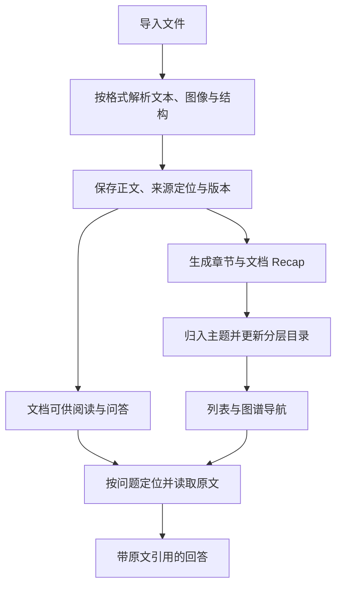

# 本地知识库、Local Search 与 Hybrid Search

## 背景介绍

研究资料往往散落在论文、报告、演示稿和表格中。文件越多，越难判断哪些资料与问题有关；把全文直接放入模型上下文，又会挤占推理空间，使回答难以对应到原文位置。

SearchOS 将资料组织成可持续维护的**本地知识库**：先保存正文、结构与来源位置，再生成主题和章节目录。提问时，Agent 沿目录定位材料，按需读取原文，并在回答中给出可打开的引用。界面中的“资料库”对应一个独立知识库。

**Local Search** 面向选中文档或当前知识库进行问答；**Hybrid Search** 由 Orchestrator 协调本地阅读与 Web 检索，将文件中的线索延伸到公开来源。知识库负责保存和组织资料，检索流程负责围绕具体问题选择、阅读和核验来源。

| 能力 | 使用方式 |
| --- | --- |
| 多格式导入 | 导入 PDF、DOCX、PPTX、XLSX、Markdown、TXT、CSV、TSV、JSON、JSONL、HTML 和常见图片 |
| 多模态解析 | 结合文件文本层和视觉解析，读取扫描页、幻灯片、图片及页面结构 |
| 分层导航 | 按“知识库 → 主题 → 文档 → 章节”定位内容，在列表和图谱间切换 |
| 知识库管理 | 新建、重命名或删除资料库，编辑文档名称，创建和维护主题 |
| 范围选择 | 查询选中文档，或让 Agent 在当前知识库内寻找相关材料 |
| 原文引用 | 从回答回到实际阅读过的页、行、幻灯片或表格区域 |
| 混合研究 | 按问题派发本地和 Web 任务，汇总各自的来源与证据 |

## 技术文档

### 从文件到可检索知识库

导入流程将“原文可读”和“目录完善”分开。解析器先提取正文、结构及来源定位信息，保存后即可参与问答；章节摘要（Recap）、文档摘要、主题归类和主题简介随后在后台补全。

解析按格式保留位置语义：文本保留行号，PDF 保留页与区域，PPTX 保留幻灯片，表格保留工作表及单元格范围。扫描件和图片通过视觉模型提取内容，生成的文本仍绑定原始页面或图像区域。模型用途设置中的文档摘要与视觉读取分别用于目录补全和视觉解析。

自动分类为文档选择一至三个主题。新增资料或修改归属时，系统增量更新受影响的目录分支；文档可以被多个主题引用，不需要复制原件。用户可手工调整为零至三个主题，并单独编辑主题名称与简介。手工名称、说明和归属保留用户的选择，后台分类不会覆盖这些设置。

### 目录定位与原文阅读

Local Search 使用三个互补的工具：

| 工具 | 输入与作用 | 返回内容的用途 |
| --- | --- | --- |
| `local_catalog` | 浏览目录或检索相关主题、文档与章节 | 缩小阅读范围 |
| `local_find` | 在指定文档或原文范围内查找关键词 | 定位相关段落 |
| `local_open` | 打开指定原文位置及其上下文 | 获取回答依据与引用 |

典型路径为 `local_catalog → local_find → local_open`。Agent 根据问题和已读取内容选择下一步，必要时继续打开相邻窗口。选中文档的正文较短时，问答入口可以先完整读取主要正文；长文档则按目录和问题逐段阅读。

Recap 与目录描述用于导航。回答中的来源支持来自实际打开的原文；在 Hybrid 流程中，本地原文窗口通过 `LocalEvidenceMiddleware` 进入证据抽取，保留文档身份与定位信息。

### Local 与 Hybrid 的来源范围

| 模式与选择 | 本地访问范围 | 执行方式 |
| --- | --- | --- |
| Local，勾选文档 | 仅选中的文档 | 文档问答 Agent 直接定位、阅读和回答 |
| Local，未勾选文档 | 当前知识库在提交时可读的文档 | Agent 在库内发现相关资料 |
| Hybrid，勾选文档 | 选中文档，加上 Web 来源 | Orchestrator 按任务需要派发本地与 Web 检索 |
| Hybrid，未勾选文档 | 当前知识库在提交时可读的文档，加上 Web 来源 | Orchestrator 规划来源、任务依赖及汇总 |

每次请求携带明确的知识库和文档范围。本地 Agent 的工具绑定该范围；Web Agent 使用 Web 工具。Hybrid 可以先读取本地材料、再根据其中线索检索网页，也可以并行处理彼此独立的问题。其他知识库不会因选择 Hybrid 自动加入来源范围。

### 文档身份、编辑与删除

系统分别保存显示名称、文档 ID、来源版本和原文定位。`local://` 引用绑定文档版本与位置，因此文档改名、主题移动和原文变更具有不同语义。

| 操作 | 数据变化 | 对阅读与引用的影响 |
| --- | --- | --- |
| 重命名资料库 | 更新库的显示名称 | 保留库内文档和索引 |
| 编辑文档名称 | 更新显示名称，保留原文件名和文档 ID | 保留来源版本与引用身份 |
| 创建或编辑主题 | 更新主题名称、说明及目录节点 | 保留主题 ID，手工内容不会被自动摘要覆盖 |
| 调整主题归属 | 更新文档与主题的关联 | 文档正文和引用保持不变 |
| 删除主题 | 移除主题及其关联 | 文档仍在库内，已解除的归属不会被后台自动恢复 |
| 删除文档 | 清除原件、解析产物与全部主题关联 | 取消相关后台作业，历史引用返回不可用 |
| 删除资料库 | 清除整个库及其资料 | 取消库内后台作业，历史引用返回不可用 |

删除文档和资料库需要在界面确认。持久化删除标记阻止尚未结束的后台任务重新发布已删除内容；前端同步清理文档选择和上传状态。读取原文时还会核对来源版本与内容哈希，避免将旧位置解析到变化后的文件。

### 接口与实现入口

Web API 以知识库为访问入口，常用管理接口如下。表中的路径均以 `/api/local` 开头。

| 接口 | 用途或请求字段 |
| --- | --- |
| `POST /libraries` | 创建资料库：`name` |
| `PATCH /libraries/{library_id}` | 重命名资料库：`name` |
| `DELETE /libraries/{library_id}` | 删除资料库 |
| `POST /libraries/{library_id}/uploads` | 上传文件 |
| `GET /libraries/{library_id}/graph` | 读取主题与文档关系 |
| `PATCH /libraries/{library_id}/documents/{document_id}` | 编辑文档显示名称：`name` |
| `DELETE /libraries/{library_id}/documents/{document_id}` | 删除文档 |
| `POST /libraries/{library_id}/topics` | 创建主题：`title`、`summary` |
| `PATCH /libraries/{library_id}/topics/{subindex_id}` | 编辑主题：`title`、`summary` |
| `DELETE /libraries/{library_id}/topics/{subindex_id}` | 删除主题 |
| `PUT /libraries/{library_id}/documents/{document_id}/topics` | 设置完整主题归属：`subindex_ids` |
| `POST /citations/resolve` | 解析引用：`ref_id` |

解析与索引位于 [`searchos/local/`](../searchos/local/README.md)，知识库操作由 [`LocalLibraryService`](../searchos/local/library.py) 管理，原文工具位于 [`reader/tools.py`](../searchos/local/reader/tools.py)，HTTP 入口位于 [`web/api/routes/local_search.py`](../web/api/routes/local_search.py)。解析和 Recap 的详细结构见[文档索引设计](local-document-recap.md)。

## 功能演示

先看 [Local Search 介绍视频](https://youtu.be/l9vEq6SdvZA)，再按下方步骤体验知识库管理、本地问答和 Hybrid 检索。

下面以用户准备的方案文档、论文 PDF 和成本表为例，展示从组织资料到联合研究的操作过程。问题是示例，回答内容取决于导入材料和实际阅读的来源。

### 演示一：组织项目资料

1. 打开知识库面板，选择**新建资料库**，命名为“检索项目”。
2. 添加方案文档、论文 PDF 和成本表。正文解析完成后即可使用；目录摘要会继续补全。
3. 在**列表**中查看资料，切到**图谱**查看主题与文档的关系。
4. 选择文档，点击**编辑名称**，为其设置易于辨认的显示名称。
5. 点击**新建主题**，填写“方案与成本”及说明；在文档详情的**主题归属**中选中该主题并保存。

这一流程形成可供后续问题重复使用的知识库。修改名称和归属后，原文位置与引用身份仍然保留。

### 演示二：从问题回到原文

选择 **Local**，勾选方案文档和成本表，输入：

> 对照方案中的部署要求和成本表，列出需要采购的资源、计费口径与依据。每项结论附原文引用。

Agent 在选定范围内定位并阅读内容。回答后点击引用，查看对应的段落、页面或表格区域，再核对结论与原始资料。

取消文档勾选后，可以改问：

> 知识库里哪些资料讨论过缓存一致性？按设计方案和风险整理，并给出原文位置。

这次 Agent 从当前知识库的目录发现相关文档，再打开原文。

### 演示三：结合本地资料与 Web

选择 **Hybrid**，保留方案文档作为本地范围，输入：

> 先读取这份方案中的技术选型，再检索相关项目的官方文档，核对接口与部署要求，并分别标明本地和 Web 来源。

Orchestrator 按问题安排本地读取与外部核验。用户可以从结果中的本地引用回到上传文件，也可以打开 Web 来源核对公开资料。

### 演示四：维护主题与资料

在演示知识库中新建一个临时主题并关联一份文档，再从主题详情选择**删除**。确认后主题消失，文档继续保留在知识库中，可以重新分配主题。

如需移除文档，在文档详情选择**删除**并确认；如需清空整个演示库，在资料库侧栏选择删除该库。确认框会说明删除范围，删除后的历史引用会显示来源不可用。
