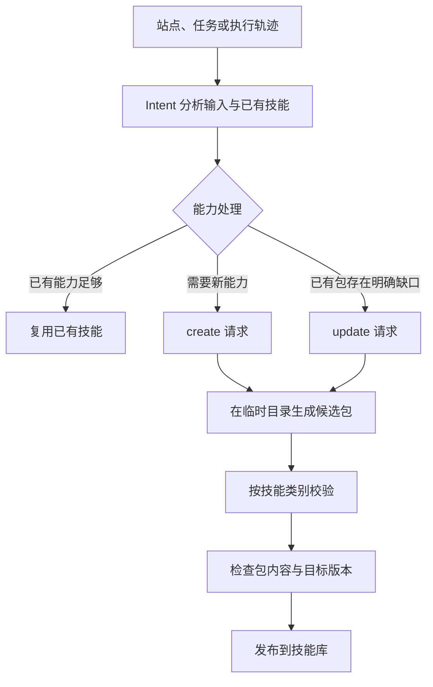

# Portable Skills：创建、复用与跨 Harness 迁移

## 背景介绍

研究过程中积累的不只是答案，还包括访问特定来源、定位资料、交叉核验和分解任务的方法。如果这些方法只保存在一次对话或专用执行器中，下一次任务需要重新摸索，换用其他 Agent Harness 时也难以复用。

SearchOS 将这些能力保存为独立的**技能包**。包内的 `SKILL.md` 描述适用场景和操作方法，普通 CLI 脚本负责需要执行的动作；宿主负责发现技能、运行命令、管理权限和处理结果。技能脚本不导入 SearchOS，因此同一包可以在 SearchOS 中创建和使用，再导出到能够读取技能说明并运行 CLI 的其他 Harness。

| 类别 | 保存的能力 | 主要使用者 |
| --- | --- | --- |
| **Access** | 来源搜索、筛选、分页、详情读取和数据导出 | 检索 Agent |
| **Strategy** | 来源选择、多跳检索、消歧、交叉核验及失败处理 | 检索 Agent |
| **Orchestrator** | 任务拆解、依赖安排、派发、停止和汇总方法 | Orchestrator |

技能包承载可复用知识和脚本。某个任务的输入、运行日志、结果文件与证据保存在宿主工作区，独立于分发包。

## 技术文档

### 技能包结构

Access 包可以包含以下文件；Strategy 与 Orchestrator 通常以说明文档为主，并按需附带参考资料。

```text
arxiv-search/
├── SKILL.md
├── scripts/
│   └── search.py
└── references/
    └── example.atom
```

`SKILL.md` 使用 YAML frontmatter 声明名称和用途，正文说明何时使用、如何调用及如何处理结果。例如：

```markdown
---
name: arxiv-search
description: 检索 arXiv 论文，保存题名、摘要和原始链接。
compatibility: Python 3；在线检索需要网络访问。
metadata:
  searchos-category: access
  host: export.arxiv.org
---

# arXiv 论文检索

根据研究主题构造查询，保存结果后阅读相关论文摘要与原始来源。
CLI 参数和输出字段由 scripts/search.py --help 说明。
```

`name` 使用小写字母、数字和连字符，并与目录名一致；`description` 提供发现技能时所需的用途说明。`compatibility` 声明解释器、依赖和网络要求。`metadata.searchos-category` 与 `metadata.host` 供 SearchOS 分类和来源发现使用，脚本自身通过 CLI 参数接收输入。

Access Builder 的 description 应包含来源名称与常见别名、具体信息对象、支持操作、关键输入输出与适用任务，并与实际实现及验收反馈保持一致。有区分度的信息放在前 500 个字符，全文遵守 1–1024 字符限制。生成提示包含国家统计局的 few-shot：

> 获取国家统计局（NBS）的数据发布、最新发布与统计解读文章。支持按栏目和页码浏览文章列表，按文章 URL 读取标题、发布日期、正文及表格；适用于定位价格指数、PMI 等统计发布，并从官方原文抽取数据。

Builder 参考其任务表达和信息组织方式，为当前站点生成有依据的描述。

包内还可使用 `references/` 保存参考材料、`assets/` 保存资源文件，并提供依赖声明。脚本应将运行结果写入调用方指定的位置，便于在不同宿主下复用。

### 参数取值查阅

城市/站点 ID、栏目/分类代码和枚举参数需说明含义、格式、编码体系及取得方式。少量固定值直接写入 SKILL.md；已获取且正文不便容纳的名称—代码目录保存在 references/ 下，采用便于查找的 Markdown、JSON 或 CSV。正文在对应参数旁链接包内文件，并说明如何按名称、地区或类别定位取值。

目录保留名称、代码、必要别名和地区层级，注明适用能力、来源 URL、获取日期、覆盖范围及更新入口。来源中的字符串代码保留前导零，样例或分批目录写清完整性与续取方式。已有查询/列表函数时，正文说明如何调用以及应传给后续命令的代码字段；动态或过大目录优先按需查询。无法获得目录时记录可操作的定位步骤与限制。

Planner 在 inputs 字符串中描述取值取得方式，在 implementation 中给出目录来源和交付建议，并复用 evidence_ids；已有查询依赖通过 depends_on 表达。Builder 将查阅文件和正文链接写入技能包。Validator 依据说明从文件或查询函数取得真实参数，复用于正常业务 CLI，并抽样核对映射与来源。

### 访问实现与依赖

Access Skill 可以用 HTTP 客户端读取 API、Feed 或静态页面，用 Scrapy 组织分页、链接跟随、去重和并发，也可以用 Playwright 完成搜索表单、筛选、滚动、动态结果等待和下载。需要多种方式时可组合实现，例如通过 [scrapy-playwright](https://github.com/scrapy-plugins/scrapy-playwright) 处理需渲染的请求。创建 Agent 根据站点实际行为选择技术；需求 Agent 定义要获取的信息及其含义。

Playwright 在 Planner 探测、Builder 调试与交付、Validator 核验中统一无头启动：Python 显式设置 `headless=True`，Node 启动配置使用 `headless: true`；持久上下文和 Scrapy 集成沿用该要求。

Planner 按能力定位实际数据来源，在 `implementation` 中简述访问入口、请求与解析方式、验证范围、选择依据和待补探测，并通过已有 `evidence_ids` 引用观察。Builder 核实建议并按新证据调整实现：可复现的 JSON、Feed 或文件请求采用 HTTP 客户端；响应中已有的 HTML/XML 使用 BeautifulSoup/lxml；动态页面通过内嵌数据、脚本配置或 Playwright 网络监听定位实际数据请求，再验证独立回放；依赖浏览器会话与交互时在函数内部管理 Playwright。Scrapy 适用于需求中的批量分页、多级发现及请求调度，按页或游标限制单次工作并提供续取方式。同站可组合多种实现，已有路径满足目标后继续核实字段与样例。

Builder 的 search/open/find 同时用于开发知识检索。实现方法、库用法、版本兼容、依赖或报错存在缺口时，围绕具体问题查阅官方文档、教程、示例、源码和 issue；打开原文核对版本与关键调用，用 exec 验证最小方法，再集成到真实站点函数并回归原输入。关键开发参考保存在 references/ 或现有记录，业务输出的 source_url 指向实际数据来源。

网页工具的作用域明确为互联网：search 通过搜索引擎检索网页，open 阅读 HTTP(S) URL 或网页结果 ID，find 按字面查找当前已打开的网页文本。Builder 定位本地代码时使用 read_file，或在 exec 中从 SKILL_DIR 读取并查找；保存结果与日志用 read_file 分页读取。Planner 的 open 另支持显式保存产物路径的分页回读。

开发自测核对关键词、标识和分页的实际效果，检查正文、日期和来源含义；重复结果、首页重定向、模板和访问拦截页分别保留诊断。URL 构造、HEAD 元数据与文件字节获取按各自交付内容验证。修复后重跑原失败输入，需求或样例调整经 Planner 修订。技术选择规则同时用于初始规划与后续澄清，Builder 提示包含气象局“模板页 → 浏览器观察 JSON 接口 → HTTP 独立回放 → 换词与翻页验证”的开发示例。

`required_fields` 支持记录顶层字段、对象点路径（如 `location.id`）和数组下标路径（如 `readings.0.temperature`）。框架对每条记录生成扁平字段索引，同时保留容器字段名，随后核对字段存在性；业务 JSON 保留原结构。来源中的 null 和空容器保留原值，缺失子字段或数组元素会报告对应路径。`source_url` 继续要求位于记录顶层并为有效 HTTP(S) URL。

包内 CLI 使用普通库完成这些操作，并在 `requirements.txt` 或 `package.json` 中声明实际依赖，在 `SKILL.md` 中说明版本、安装和浏览器要求。业务函数封装数据获取、超时和失败处理。代理地址与选线由宿主管理，脚本通过客户端原生代理支持接入标准环境变量，aiohttp 显式设置 `trust_env=True`。新包无需线路文件、代理 helper 或 SearchOS 导入。Scrapy 支持通过脚本启动爬取，Playwright 需要同时准备 Python 库与浏览器引擎，参见 [Scrapy 脚本入口](https://docs.scrapy.org/en/latest/topics/practices.html)与 [Playwright 安装说明](https://playwright.dev/python/docs/library)。

SearchOS 的 `access` 可选依赖组包含 Scrapy、Playwright 和 scrapy-playwright。宿主环境可用 `python -m pip install -e '.[access]'` 和 `python -m playwright install chromium` 准备；迁移到其他 Harness 时按具体技能包的依赖安装。写入依赖文件不会自动安装库。

Planner、Builder 与 Validator 共用 `exec(argv|code, stdin?, browser?, timeout_s?)`，每次选择命令或 Python 代码。命令支持解释器选项、模块、普通程序与 shell；代码使用 `execute_python → execute_command`，共用系统隔离后端、任务网络配置和输出限制，支持已安装的 HTTP、Scrapy 与 Playwright 库及其子进程。宿主为脚本和浏览器配置同一网络上下文中的本地入口，按 Execution Policy 限制可访问的目标。爬取和交互设置时间、页数、并发与结果数量上限；验收使用有代表性的小规模操作。

三个角色先使用宿主当前线路执行正常业务请求；连接失败或有证据表明出口导致业务访问失败时，通过 `network_check(url)` 检查连接，可追加 `route="direct"` 或 `route="proxy"` 在当前任务试用候选线路。确认 `selected_route` 后，以新建客户端连接复验原业务输入。候选线路在业务验收前仅供当前任务使用，Validator 根据通过报告引用的真实正常业务执行确认线路，宿主保存对应主机、端口和代理配置，后续执行自动复用。人工规则和关闭自动选线的设置继续生效；使用代理前需由宿主配置可用代理。访问权限拒绝、登录、限流与解析错误分别处理。脚本和正式调用只传查询、分页和输出等业务参数，原失败输入保留回归义务。

项目 `network` 配置统一指定代理与自动选线。配置代理时默认走代理，留空时默认直连。每个任务固定配置快照，设置变更用于新任务，恢复任务采用当前配置并复验。子进程的大小写 `HTTP_PROXY`、`HTTPS_PROXY` 和 `ALL_PROXY` 只指向本地入口，`NO_PROXY` 仅绕过本地控制连接；上游代理凭据留在宿主。实际连接的配置指纹、线路与失败阶段随执行记录保存，业务请求和认证信息不进入连接日志。

明确配置的本地模型和其他回环 API 默认直连。公网目标由宿主解析、校验并连接固定 IP，使用上游代理时继续保留这项检查；DNS 校验失败会返回诊断。自动线路仅记录实际主机与端口，有效期 24 小时，代理配置改变后失效。人工域名规则优先，关闭自动选线后使用人工规则或默认线路。清除自动记录会使未完成请求中的旧线路确认失效。

网关只在转发业务字节前自动更换连接。读取客户端可对尚未获得响应的安全读取尝试一次备用线路，登录、写入、未知 CLI 和已开始的流式输出由调用方处理。普通脚本通过原生代理支持接入，发布验收核对真实连接记录；浏览器额外受系统端口隔离约束。诊断中的连接成功仍需后续业务调用验证，HTTPS 隧道不解密页面内容。

Access 三个角色的执行默认 60 秒，可通过 `timeout_s` 指定 0.1–300 秒。连接、读取、重试、退避、浏览器启动与渲染共用总预算；函数使用 monotonic deadline 分配各阶段期限，并预留解析、输出与资源关闭时间。浏览器按目标响应或元素就绪结束等待。超过总期限时执行后端终止命令并保留已产生的输出；其他类别的 CLI 沿用各自的执行配置。

### 构建结果与长文本读取

执行期间按块保存 stdout/stderr，Access 回执返回执行状态、退出码、持久的 `stdout_file/stderr_file` 与短预览。完整输出生成稳定的脱敏文件，工具回执的 UTF-8 序列化总大小上限为 24,000 字节；大数组、嵌套 JSON 和长字段超限后均返回完整 `result_file`。Builder 与 Validator 用 `read_file(path, offset, limit)` 按字符续读；Planner 的 `open` 也接受已保存文件路径。读取窗口沿 `next_offset` 推进，实际窗口同时受回执字节预算约束。首次读取生成脱敏快照和稀疏索引，后续页仅读取所需窗口。每次模型调用前检查完整历史，超过 96,000 字节时归档对话，复用 Context Middleware 的有界分块摘要生成续接说明，保留当前任务、候选状态和最近完整工具轮次。摘要请求独立记录；失败或超时时使用归档与状态继续。压缩完成后追加本轮 user 提示。

构建记录中的研究观察、计划和恢复状态完整脱敏保存；日志摘要单独使用长度限制。完整分页结果存放在构建记录目录，不进入分发技能包。代码探测、CLI 调试与验收的每个输出流最多捕获 10 MB，Builder 可分页阅读完整捕获日志；超限明确报告 `output_limit_exceeded`。正式 CLI 验收读取完整捕获输出，或读取声明的 JSON 输出文件。

### 从输入信号创建或更新技能

创建流程分为 Intent 与 Pipeline。Intent 判断输入中是否存在值得复用的能力缺口，Pipeline 生成候选包并完成对应类别的校验。



三种输入分别对应不同的分析起点：

- **站点**：提供 URL 与希望获取的能力，面向该来源创建 Access 包。
- **任务**：描述目标与需要的结果，分析所需的访问、检索和编排能力。
- **轨迹**：提供任务上下文和执行记录，从实际使用过程发现可复用的缺口。

任务与通用轨迹分析可以产生 `action=create` 或 `action=update` 请求。更新沿用已有技能的名称和类别，`reason` 说明缺口及需要保留的能力；生成器读取原包，在候选目录中修订。已有能力足够时可以不产生请求。

校验方式与包的职责对应：

| 类别 | 入库前的处理 |
| --- | --- |
| Access | 创建 Agent 实现 CLI，独立验证 Agent 执行固定验收并检查真实命令、输出语义和来源依据 |
| Strategy | 将候选方法应用到具体子任务，由独立 Judge 检查答案及来源支持 |
| Orchestrator | 检查包名称、类别、说明结构与非空内容 |

站点创建的 Access Pipeline 使用三个独立上下文，工具与职责如下：

| Agent | 工具 | 职责 |
| --- | --- | --- |
| `SitePlannerAgent` | search、find、open、exec | 探索来源并通过最终 JSON 交付开发计划，按消息澄清需求 |
| `AccessBuilderAgent` | search、find、open、exec、read_file、write_file、edit_file、send_message | 实现技能包并调试，通过消息提交候选 |
| `ValidationAgent` | read_file、exec、send_message | 读取固定候选，独立运行业务 CLI，核验内容与来源并返回逐能力结论 |

外层 `skills/intent` 将任务、轨迹或站点输入转为 `SkillRequest`；内层 `access/agents/planner.py` 阅读站点并规划能力。`access/pipeline.py` 串联角色、恢复与交付；`tools/files.py` 管理候选文件，`tools/execute.py` 管理执行，`validation/checks.py` 进行静态预检并校验已经产生的结果，`validation/progress.py` 管理函数级复验与原失败补验。角色通过输入快照和进度回调交接验收状态。目录、调用链与状态归属见 [Access Pipeline 开发入口](../searchos/skills/pipeline/access/README.md)。

`send_message(role, content)` 使用进程内顺序交接。Builder 向 `validator` 提交时暂停，宿主复制不可变候选并冻结当前计划和样例；Validator 返回报告后恢复 Builder。Builder 和 Validator 都可以向 `planner` 提问。Planner 返回完整修订计划时，宿主更新固定目标，历史计划与依据继续保留。

三个角色的 `exec` 每次选择 `argv` 或 `code`。Builder 与 Validator 的代码通过 Python `Path` 变量 `SKILL_DIR` 读取当前候选的只读快照，子进程通过同名环境变量访问；宿主授权当前会话结果路径与已登记源文件只读。`read_file` 支持候选相对路径、`SKILL_DIR/` 前缀及结果绝对路径，并按字符分页。执行输出写入角色工作目录；Planner 使用独立研究目录。探测代码原样执行，通过原生客户端接入宿主代理环境。函数封装访问方式、超时和必要的业务重试，登录凭据由宿主托管会话保护。

Builder 每轮调用 LLM 前，框架按候选版本进行静态预检，反馈包结构和 host 等缺项；文件或计划改变后重新检查。静态预检只读取文件，不消耗独立验收轮次。正式交验时再次检查不可变候选。Validator 使用 `exec(argv=...)` 或 `exec(code=...)` 自主调用，读取原始输出、核对内容并提交报告。报告引用已有执行编号，框架复用完整 stdout 或冻结的 JSON 产物检查退出状态与可解析性；宿主固定样例还检查结果路径、必需字段和来源 URL。Python 包装调用可通过断言核验业务结果。`--help`、来源探测及边界观察按需执行。

正式验收先扫描包内 Python 函数并保存内容索引，包含异步函数、类方法和嵌套函数。独立业务 CLI 在同一次执行中记录包内调用函数；框架结合正文中的包内函数引用记录每项能力的函数范围。下一次交验仅派发未通过、相关函数内容变化或本能力契约变化的能力。已通过且相关内容未变的能力保留原执行 ID、候选版本及验收会话，并与本轮结果合并。共享函数修改会使使用者进入复验；导入、全局配置、依赖、正文和参考资源变化时扩大复验。无法解析、缺少完整调用记录、子进程取数及非 Python 入口采用完整复验。工具集合和单次执行规则保持原约定。

Validator 使用 `send_message(role="builder", content={"checks":[...],"repair_budget":{"max_turns":20,"reason":"修复映射并补测边界"}})` 提交报告。每项包含 `capability_id`、`status`（`passed/failed/uncertain`）、具体 `reason` 与 `executions`。执行引用示例为 `{"execution_id":"exec-…","output":"result.json","regression_of":"exec-旧失败"}`。省略 `output` 时由 Validator 核对原始输出或断言；`output=""` 要求 stdout 为 JSON，相对路径指定本次生成的 JSON 文件。`regression_of` 关联原失败，`check_kind` 与 `expected_status` 可记录边界分类。上述元数据全部在报告阶段提交。框架核对实际执行、当前候选版本和文件更新，Validator 核对业务归属、普通参数、位置参数及 stdin 的效果。同一次执行可支撑多项能力。仍需修复或补验时，Validator 指定 1–50 次 Builder 调用及原因，分批报告保留有效预算。

Planner 提供业务目标与研究依据，Builder 将实际接口写入 SKILL.md。每项可用能力需要正常业务执行和语义确认；分页、边界和来源等具体需求由 Validator 核验。调用方显式提供的固定样例保留原约束。框架按当前候选的真实记录关联报告，保留 `deterministic` 与 `semantic` 字段，分别记录同一次执行的机器检查和模型判断。原失败输入持续进入回归队列，改查询或删除样例仍需复验原问题。

候选文件、计划或验收目标变化后生成新版本，按函数内容、调用范围和能力契约计算待验能力。相同版本全部通过且没有待补验原输入时复用报告；失败、`incomplete` 或语义调用错误继续进入验收。同一构建会话内补验保留实际执行用例、观察及有效结论，继续处理缺项与需要重试的命令。同能力、同类型、同参数命令的重试更新当前用例，历史执行仍保存在观察记录中；取消后重新确认。报告附逐能力待办，分别要求修复代码、补齐验收或提交新候选。Builder 在同一主循环处理开发、交验与修复，新失败交验返回后立即按 Validator 指定额度开启修复阶段；相同报告只分配一次。静态拒收或旧报告缺少预算时，后备额度为 50。阶段额度耗尽且当前候选遗漏交接时，框架在剩余验收轮数内补一次交接。`max_repair_attempts` 配置本次构建最多追加的验收轮数，默认初验一次加最多三轮。

修复反馈的 `package_files` 给出当前包目录，`next_actions[].functions` 给出函数标识、包内相对路径、行号、内容指纹和可直接调用的 `read_file` 参数。读取参数按脱敏后的 Unicode 字符计数，兼容中文、BOM 和通用换行；沿 `next_offset` 读至 `end_offset`。包文件修改使用相对路径，`exec(code)` 通过 Python `Path` 变量 `SKILL_DIR` 只读访问候选。文件定位失败时返回目录与恢复读取建议；Builder 先读取目标函数、局部修改并自测，再交验。每轮历史压缩后重新注入定位反馈；超长反馈保留首批可执行读取项，完整清单落盘分页。

Validator 将原失败命令、stdin 及其 `expected_status`、`check_kind`、输出位置、记录路径和必需字段保存为回归队列。每轮显示 `pending_regressions`；相同输入按原契约成功执行后消除对应缺口，新增查询的成功结果继续保留原失败项。未补齐时拒收该能力的 `passed` 并返回待办，Agent 继续当前循环。原输入同时检查当前计划新增的字段要求。语义失败关联的正常与边界输入均需再次执行并核对。若原预期有误，Planner 需修订同输入的边界样例并给出原因及来源依据，Builder 接收修订、重交后执行新预期，报告保留前后契约。原始执行和修订证据继续保存在会话记录中。

Access 按能力保存 `available/unavailable/incomplete`：分别表示当前版本通过执行结果检查与语义验收、已有具体失败、验收未完成或存在外部阻碍。`valid` 表示全部能力通过，`package_valid` 表示包结构有效。结构有效的部分产物可带能力状态入库；结构不完整时保留草稿。

框架由 `capability_results` 生成发布副本的能力表和紧凑 `metadata.searchos-capabilities`，每项公开状态仅保存 `status`。原因、机器检查、语义判断和执行证据保存在构建记录。状态注解只写入发布副本。

`installed` 表示包已入库，调用方通过发现与加载结果查看各能力状态；包级 `enabled/disabled` 保持原含义。旧包缺少状态字段时维持原行为。相关代码或验收目标修改使该能力旧结论失效，报告缺失的能力保留 incomplete。

生成过程保留已有包，候选形成后连同逐能力状态发布。更新发布前重新核对原包哈希，避免覆盖生成期间发生的其他修改；发布替换失败时恢复旧版本。运行时已加载的任务继续使用自己的包快照及能力状态，新任务可加载更新后的包。

**运行结束后的技能生成**采用同一条轨迹分析流程，可以创建或更新 Access、Strategy 和 Orchestrator 三类技能。用户在**设置 → 技能**中选择开启，使用分配给技能创建的模型。后端保留 `enable_access_skill_generation` 和 `access_skill_max_per_run` 配置名，以兼容已有配置；其作用范围已覆盖三类技能。结束后的 Strategy 校验在独立子任务中执行。

公开 Python 入口位于 [`searchos.skills`](../searchos/skills/__init__.py)：`generate_skills` 串联信号分析与生成，`run_pipeline` 接收明确的 `SkillRequest`，`generate_from_trace` 处理运行结束后的轨迹。请求字段见 [`intent/models.py`](../searchos/skills/intent/models.py)，校验与发布顺序见 [`pipeline/run.py`](../searchos/skills/pipeline/run.py)。

### 在 SearchOS 中发现、加载与执行

Agent 通过固定工具接口使用技能。技能推荐帮助它选择候选包，用户的技能白名单、禁用设置和来源范围决定哪些包可以发现与执行。

| 工具 | 作用 |
| --- | --- |
| `list_skills` | 按类别和关键词发现技能 |
| `load_skill` | 读取说明，并为当前任务保存包快照 |
| `read_skill_file` | 分页阅读包内参考资料 |
| `exec` | 执行代码或命令，通过 SearchAnything 编排已加载技能 |
| `open` / `find` | 阅读保存的结果页面并定位内容 |

通用 `exec` 接收 `argv` 或 Python `code`，以及 `inputs`、`stdin` 和 `timeout_s`。`load_skill` 返回 `command_prefix`，例如 `["searchanything", "run", "arxiv-search", "--"]`；将前缀与文档中的命令、包内脚本和业务参数拼接后交给 `exec(argv=...)`。多步任务在 `exec(code=...)` 内通过 subprocess 调用技能，解析 stdout、筛选记录并保存文件。宿主统一选择网络路线，脚本使用客户端原生代理支持并返回业务数据或错误。Search、Explore 根据失败回执决定等待、调整查询、改用授权来源或报告缺口；技能重试依据包内文档和执行结果，并遵守请求间隔、限流退避与部分结果保存要求。连接诊断保留在宿主、管理页和技能创建流程，正式检索工具集与 SearchAnything CLI 移除诊断入口。

同一任务复用 Exec 工作目录，技能子调用共享独立的任务技能目录，通过 stdin/stdout 与父程序交换数据。并发访问同一工作目录时由宿主排队，等待和执行均受父 Exec 时限约束。包快照只读，不同任务的工作目录相互隔离并可并行执行；未绑定任务时按 Agent 隔离。Python 使用宿主解释器，其他解释器及依赖按包声明准备。macOS 执行后端为 `sandbox-exec`，Linux 为 `bubblewrap`；后端不可用时返回 `blocked`，由宿主报告执行状态。

托管浏览器跨创建任务内的多条命令和三个角色存活。包通过 `searchos-browser-profile: managed` 与 `searchos-browser-entries` 声明入口；脚本连接执行环境中的 `BROWSER_CDP_URL`，宿主负责关闭和保存站点 profile。命令默认 60 秒、最高 300 秒，用户等待单独计时；外部条件阻塞保留 `incomplete / wait_external`，结构有效的包继续部分交付。详见[本机站点浏览器会话](/Users/jeffzhang/Desktop/SearchForge/SearchOS-pub/docs/skill_browser_auth.md)。

普通 CLI 执行直接运行包内脚本；模型用于技能选择、创建及后续推理。Local 文档问答使用本地阅读工具，Access 技能用于允许相应来源访问的研究任务。

### 从脚本结果到研究证据

同一站点或账号的远程请求顺序执行；技能或服务未指定间隔时，每次请求前重新从 0–1 秒均匀随机采样等待时间，使用 `time.sleep(random.uniform(0.0, 1.0))`。已明确的服务间隔、`Retry-After` 和限流退避规则优先。编排时将等待时间计入批量大小和执行预算。

`exec` 返回执行状态、退出码、stdout/stderr 预览和保存页面链接。`streams.stdout` 与 `streams.stderr` 分别提供 `shown_chars`（本次展示字符数）、`total_chars`（保存文本总字符数）、`truncated`（预览是否截断），有保存文本时提供各自的 `page_url`。字符数按 Unicode 字符计算，经过回执总大小裁剪后重新统计；总长度无法取得时为 `null`。`log_truncated=true` 表示执行输出超过捕获上限，保存文本也有缺失。Agent 通过对应的 `page_url` 和原 `open/find` 续读所需字段，对未读到的内容保留未知。工作区保存命令产物的快照及文件哈希。同一 tool-call ID 的回放使用已有回执，避免重复启动程序。

父 Exec 的 `child_results.items` 保存技能子调用的名称、参数、执行状态，以及 stdout/stderr 各自开头最多 512 个 Unicode 字符的原始预览。每项的 `streams` 提供 `shown_chars`、`total_chars`、`truncated` 与读取 URL。整个回执超过 24,000 字节时，先缩短 stdout/stderr 预览，再减少内联子调用条目，并按实际展示内容更新字符数和截断标记；保存的原始输出和索引保持完整。`child_results` 的 `shown`、`total`、`truncated` 描述回执中的条目窗口。完整索引始终通过 `child_results.page_url` 提供，沿用 `open/find` 阅读。索引覆盖失败、预算拒绝和中断调用，有保存输出时提供读取入口。聚合结果为空或缺少判断所需字段时，Agent 可先根据预览定位子调用，再读取其完整结果，并将其 URL 通过 `inputs` 传给下一次 Exec 处理。索引和中断日志保留执行信息，成功技能结果复用原页面与证据身份。

成功执行产生的 JSON 和文本结果可以自动转为稳定的 `skill://` 页面。普通 JSON 记录即可使用，脚本也可以显式保存来源正文，例如：

```json
{
  "records": [
    {"title": "论文标题", "source_url": "https://example.org/paper"}
  ],
  "sources": [
    {"url": "https://example.org/feed", "content": "获取到的原始来源正文"}
  ]
}
```

Access 能力的交付粒度由用户用途和站点实际信息共同确定。新闻聚合可以交付摘要与原文链接，目录或检索可以交付条目与详情链接，正文读取再交付原文内容。满足需求的列表或摘要能力可以独立成立，不因链接指向外站就必须逐条读取。

`source_url` 表示与记录对应、有来源响应依据的 HTTP(S) 链接，可以指向原始报道、实体详情、目录条目或实际读取页面，不要求与入口同域，也不要求已打开目标。需要保留实际获取位置时，可按需用 `retrieved_from` 记录聚合页或 API 地址。技能说明应写清来源字段含义和返回内容的粒度，不能把摘要声称为全文，或把返回原文链接声称为已核实原文。

三个 Agent 使用各自的调用额度。Planner 默认参数为 50，单次研究会话总计最多 51 次调用，最后三次用于最终 JSON 整理；Builder 默认 50 次开发调用与三次收尾机会，全程保留完整工具并在同一循环处理交验和修复。每次新失败交验按 Validator 指定的 1–50 轮切换修复阶段，受最多四轮验收及 `max_turns + 3 + 50 × max_repair_attempts` 总调用硬上限约束，默认最多 203 次。修复额度包括读写、探查、自测和交验。Validator 每轮默认 50 次调用、一次补验与最多三次最终报告调用。每次模型调用前，在上下文压缩之后注入实时预算，显示当前角色、阶段、调用序号、当前额度剩余次数、阶段剩余次数和总预算；剩余次数均包含即将开始的本次调用。Builder 的信号还包含本轮修复额度及原因、已用验收轮数和剩余验收次数。Planner 的澄清会话与 Validator 的补验会话分别显示当前会话额度，摘要请求单列。收尾阶段保持工具定义。Planner 的整理调用由执行层拦截研究工具，直接输出 JSON；Validator 的最终报告阶段仅向 Builder 提交报告。Builder 继续读取、写入、执行和交验，静态或独立验收失败返回同一 LLM 循环，末段自动交验失败也继续给出修复机会。明确的网关未知工具 400 使用剩余额度纠正；取消继续传播。参数分别为 `planner_max_turns`、`max_turns`、`validation_max_turns`，公共 Pipeline 和实验 CLI 继续提供对应配置。取消时保存已有文件、输出引用、验收状态和已消耗轮数，恢复后核验当前包版本。

超时或取消时，已有候选文件另存到构建记录的 `artifact/<name>/`，由 `artifact.json` 记录交付状态，`artifact_path` 指向该产物；正式入库仍使用 `path`。标准包结构有效的产物附带当前版本的逐能力状态，未验能力保留 `incomplete`，受实现修改影响的旧 `available` 不复用。结构不完整的文件也保留为原始产物，标记 `status=draft`、`package_valid=false`，不声明可加载；没有文件时不创建产物。原始草稿和验收记录继续保留。

交付只整理已生成文件，不追加模型、网站或 CLI 验收，也不吞掉取消异常。`CancelledError` 继续向调用者传播，显式整站超时继续抛出 `TimeoutError`。站点实验默认 `timeout_s=None`，不设整站墙钟期限；需要限制时传入正数，各工具自身的执行时限仍然生效。

技能子调用的成功业务 JSON stdout 直接提交证据抽取，后续打开同一结果页时去重。输出预览不足时，Agent 通过 `page_url` 和原 `open/find` 阅读完整文本。页面元数据保留包版本、执行 ID、文件哈希和生产任务。普通代码产物供后续计算与阅读，结论仍须结合原始来源核验。

执行索引、日志、错误输出以及带 fixture 标记的示例数据作为非证据页面处理。结果页面在会话工作区中保存，后续读取可以恢复保存的页面内容，无需重新执行脚本。

### 校验、安装与导出

包管理命令独立于模型调用：

```bash
searchos skills validate /path/to/arxiv-search
searchos skills install /path/to/arxiv-search --library /path/to/library/access
searchos skills export /path/to/arxiv-search --output /path/to/export/arxiv-search
```

`validate` 检查标准包结构、名称与路径；创建 Pipeline 另行执行前述类别校验。`install` 将包放入指定库目录下，`export` 生成独立目录副本，目标目录末级名称与技能名一致。安装和导出要求目标包目录不存在，并排除缓存、日志和常见凭据文件；符号链接不进入分发包。

跨 Harness 迁移保留 `SKILL.md`、脚本、参考资料和依赖声明。目标宿主读取说明，准备声明的依赖，再通过自己的终端或执行工具调用脚本。权限、任务目录、结果阅读及证据处理由目标宿主提供，SearchOS 的工具名称不构成包的运行依赖。

已迁移包的旧名称通过名称映射继续解析。加载与执行要求 `SKILL.md` 标准包；旧 `skill.md + manifest.yaml + executor.py` 包须先通过离线迁移生成标准包。旧执行器、代理补丁与 `legacy-executor` 调用入口已删除。

来源发现只索引通过标准包校验的 Access 技能，跳过隔离、隐藏和无效包；有效的 disabled 包继续视为已有技能，保留用户的禁用选择。运行时解析器已删除 manifest 回退与 executor 文件探测，旧 manifest 读取集中在离线迁移工具。2026-10-23 已归档清理 9 个孤儿目录及 16 个拒收历史包，471 个标准 Access 包的路径和内容指纹保持一致。

## 功能演示

### 演示一：从站点创建技能

1. 打开 Web 侧栏的**技能库**，点击**创建技能**，选择**从站点**。
2. 输入目标站点 URL，例如 `https://www.datamuse.com/api/`，描述希望学习的查询和筛选能力。
3. 提交后查看创建进度。生成器探测来源、编写脚本并执行样例；离开页面后任务继续运行。
4. 完成后在技能库查看包内的 `SKILL.md`、脚本和参考资料，以及逐能力的可用状态与限制。创建历史中的入库状态表示包已保存；各能力的验收状态分别记录。

例如，可以填写：“查询与给定英文词相关的词语，支持前缀筛选，并保留来源链接。”这段文字描述生成目标，具体 CLI 参数以生成包的说明和 `--help` 为准。

### 演示二：发现并补齐已有技能的能力缺口

在**创建技能 → 从轨迹**中提供实际运行记录，并补充当时的目标、使用的技能和未完成的步骤。例如，某次任务需要翻页获取更多记录，而已有技能只有首屏查询能力。

Intent 会结合轨迹与已有包内容判断是否需要更新。若产生 `update` 请求，创建历史显示目标技能与更新动作；候选完成生成和校验后替换原包。更新过程沿用包名，并将保留原能力作为生成要求。

对连续研究任务，也可以在**设置 → 技能**开启运行结束后的生成，让系统根据完整轨迹分析三类技能的新增或更新需求。

### 演示三：执行论文检索并阅读结果

下面是 Agent 工具调用示例，使用仓库中的 `arxiv-search` 包。`<page_url>` 替换为 `exec` 实际返回的链接。

```text
list_skills(query="arxiv", limit=20)
load_skill(skill_name="arxiv-search")
exec(argv=[
  "searchanything", "run", "arxiv-search", "--",
  "python", "scripts/search.py",
  "--query", "all:retrieval", "--limit", "5"
])
open(id_or_url="<page_url>")
find(pattern="retrieval")
```

这组操作依次完成发现、加载、检索、保存和阅读。Agent 从结果中选择相关论文，再按研究问题继续打开来源；回答中使用实际阅读并核验的内容。

### 演示四：导出到其他 Harness

在仓库根目录运行以下命令，将目标路径替换为本机准备好的导出目录：

```bash
searchos skills validate searchos/skills/library/access/arxiv-search
searchos skills export searchos/skills/library/access/arxiv-search \
  --output /path/to/export/arxiv-search
```

将导出目录放入目标 Harness 支持的技能位置，或让其读取该目录中的 `SKILL.md`。然后使用目标宿主的终端运行：

```bash
cd /path/to/export/arxiv-search
python scripts/search.py --help
python scripts/search.py --query 'all:retrieval' --limit 5 --output papers.json
```

脚本在导出目录中独立运行，生成的 `papers.json` 可由目标宿主继续读取。若要安装到另一套 SearchOS 技能库，可运行：

```bash
searchos skills install /path/to/export/arxiv-search \
  --library /path/to/another-library/access
```
