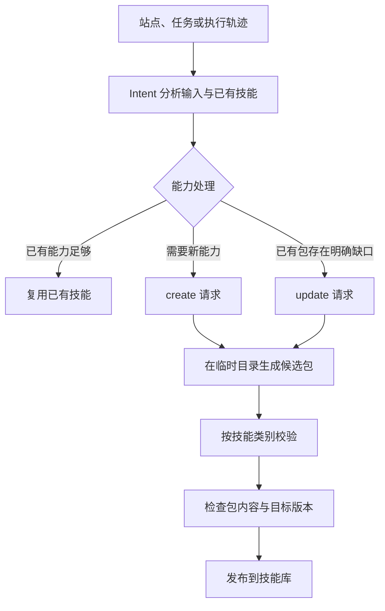

# Portable Skills：创建、复用与跨 Harness 迁移

## 背景介绍

研究过程中积累的不只是答案，还包括访问特定来源、定位资料、交叉核验和分解任务的方法。如果这些方法只保存在一次对话或专用执行器中，下一次任务需要重新摸索，换用其他 Agent Harness 时也难以复用。

SearchOS 将这些能力保存为独立的**技能包**。包内的 `SKILL.md` 描述适用场景和操作方法，普通 CLI 脚本负责需要执行的动作；宿主负责发现技能、运行命令、管理权限和处理结果。技能脚本不导入 SearchOS，因此同一包可以在 SearchOS 中创建和使用，再导出到能够读取技能说明并运行 CLI 的其他 Harness。

| 类别 | 保存的能力 | 主要使用者 |
| --- | --- | --- |
| **Access** | 来源搜索、筛选、分页、详情读取和数据导出 | 检索 Agent |
| **Strategy** | 来源选择、多跳检索、消歧、交叉核验及失败处理 | 检索 Agent |
| **Orchestrator** | 任务拆解、依赖安排、派发、停止和汇总方法 | Orchestrator |

技能包承载可复用知识和脚本。某个任务的输入、运行日志、结果文件与证据保存在宿主工作区，独立于分发包。

## 技术文档

### 技能包结构

Access 包可以包含以下文件；Strategy 与 Orchestrator 通常以说明文档为主，并按需附带参考资料。

```text
arxiv-search/
├── SKILL.md
├── scripts/
│   └── search.py
└── references/
    └── example.atom
```

`SKILL.md` 使用 YAML frontmatter 声明名称和用途，正文说明何时使用、如何调用及如何处理结果。例如：

```markdown
---
name: arxiv-search
description: 检索 arXiv 论文，保存题名、摘要和原始链接。
compatibility: Python 3；在线检索需要网络访问。
metadata:
  searchos-category: access
  host: export.arxiv.org
---

# arXiv 论文检索

根据研究主题构造查询，保存结果后阅读相关论文摘要与原始来源。
CLI 参数和输出字段由 scripts/search.py --help 说明。
```

`name` 使用小写字母、数字和连字符，并与目录名一致；`description` 提供发现技能时所需的用途说明。`compatibility` 声明解释器、依赖和网络要求。`metadata.searchos-category` 与 `metadata.host` 供 SearchOS 分类和来源发现使用，脚本自身通过 CLI 参数接收输入。

包内还可使用 `references/` 保存参考材料、`assets/` 保存资源文件，并提供依赖声明。脚本应将运行结果写入调用方指定的位置，便于在不同宿主下复用。

### 从输入信号创建或更新技能

创建流程分为 Intent 与 Pipeline。Intent 判断输入中是否存在值得复用的能力缺口，Pipeline 生成候选包并完成对应类别的校验。



三种输入分别对应不同的分析起点：

- **站点**：提供 URL 与希望获取的能力，面向该来源创建 Access 包。
- **任务**：描述目标与需要的结果，分析所需的访问、检索和编排能力。
- **轨迹**：提供任务上下文和执行记录，从实际使用过程发现可复用的缺口。

任务与通用轨迹分析可以产生 `action=create` 或 `action=update` 请求。更新沿用已有技能的名称和类别，`reason` 说明缺口及需要保留的能力；生成器读取原包，在候选目录中修订。已有能力足够时可以不产生请求。

校验方式与包的职责对应：

| 类别 | 入库前的处理 |
| --- | --- |
| Access | 探测来源能力，生成独立 CLI，执行 `--help` 和登记的 CLI 样例，检查结果及来源信息 |
| Strategy | 将候选方法应用到具体子任务，由独立 Judge 检查答案及来源支持 |
| Orchestrator | 检查包名称、类别、说明结构与非空内容 |

生成过程保留已有包，待候选通过校验后再发布。更新发布前重新核对原包哈希，避免覆盖生成期间发生的其他修改；发布替换失败时恢复旧版本。运行时已加载的任务继续使用自己的包快照，新任务可加载更新后的包。

**运行结束后的技能生成**采用同一条轨迹分析流程，可以创建或更新 Access、Strategy 和 Orchestrator 三类技能。用户在**设置 → 技能**中选择开启，使用分配给技能创建的模型。后端保留 `enable_access_skill_generation` 和 `access_skill_max_per_run` 配置名，以兼容已有配置；其作用范围已覆盖三类技能。结束后的 Strategy 校验在独立子任务中执行。

公开 Python 入口位于 [`searchos.skills`](../searchos/skills/__init__.py)：`generate_skills` 串联信号分析与生成，`run_pipeline` 接收明确的 `SkillRequest`，`generate_from_trace` 处理运行结束后的轨迹。请求字段见 [`intent/models.py`](../searchos/skills/intent/models.py)，校验与发布顺序见 [`pipeline/run.py`](../searchos/skills/pipeline/run.py)。

### 在 SearchOS 中发现、加载与执行

Agent 通过固定工具接口使用技能。技能推荐帮助它选择候选包，用户的技能白名单、禁用设置和来源范围决定哪些包可以发现与执行。

| 工具 | 作用 |
| --- | --- |
| `list_skills` | 按类别和关键词发现技能 |
| `load_skill` | 读取说明，并为当前任务保存包快照 |
| `read_skill_file` | 分页阅读包内参考资料 |
| `exec` | 执行已加载包中的 CLI 脚本 |
| `open` / `find` | 阅读保存的结果页面并定位内容 |

执行参数使用数组，例如 `argv=["python", "scripts/search.py", "--query", "all:retrieval"]`。首项为支持的解释器，第二项为包内脚本；支持 Python、Shell 和 Node，不接受内联代码或任意 shell 命令字符串。

同一任务的调用串行执行并共享可写工作目录，前一步输出可以作为后一步输入。同轮并发提交的调用由宿主等待工作目录锁，等待可取消，上限为 300 秒；等待超时的调用未启动脚本，不计执行预算。执行超时从获得锁后单独计算。包快照只读，不同任务的工作目录相互隔离并可并行执行；未绑定任务时按 Agent 隔离。Python 使用宿主解释器，其他解释器及依赖按包声明准备。macOS 执行后端为 `sandbox-exec`，Linux 为 `bubblewrap`；后端不可用时返回 `blocked`，由宿主报告执行状态。

普通 CLI 执行直接运行包内脚本；模型用于技能选择、创建及后续推理。Local 文档问答使用本地阅读工具，Access 技能用于允许相应来源访问的研究任务。

### 从脚本结果到研究证据

`exec` 返回执行状态、退出码、stdout/stderr 摘要和保存页面链接，并在工作区保存命令产物的快照及文件哈希。同一 tool-call ID 的回放使用已有回执，避免重复启动程序。

成功执行产生的 JSON 和文本结果可以自动转为稳定的 `skill://` 页面。普通 JSON 记录即可使用，脚本也可以显式保存来源正文，例如：

```json
{
  "records": [
    {"title": "论文标题", "source_url": "https://example.org/paper"}
  ],
  "sources": [
    {"url": "https://example.org/feed", "content": "获取到的原始来源正文"}
  ]
}
```

Agent 收到 `page_url` 后，通过 `open` 和 `find` 阅读结果。页面元数据保留包版本、执行 ID、文件哈希和生产任务；阅读窗口沿用 Web 证据抽取与核验流程，能够从结论追溯到执行产物与来源内容。执行完成本身不等于证据提交，实际打开的结果内容才进入阅读和抽取流程。

执行索引、日志、错误输出以及带 fixture 标记的示例数据作为非证据页面处理。结果页面在会话工作区中保存，后续读取可以恢复保存的页面内容，无需重新执行脚本。

### 校验、安装与导出

包管理命令独立于模型调用：

```bash
searchos skills validate /path/to/arxiv-search
searchos skills install /path/to/arxiv-search --library /path/to/library/access
searchos skills export /path/to/arxiv-search --output /path/to/export/arxiv-search
```

`validate` 检查标准包结构、名称与路径；创建 Pipeline 另行执行前述类别校验。`install` 将包放入指定库目录下，`export` 生成独立目录副本，目标目录末级名称与技能名一致。安装和导出要求目标包目录不存在，并排除缓存、日志和常见凭据文件；符号链接不进入分发包。

跨 Harness 迁移保留 `SKILL.md`、脚本、参考资料和依赖声明。目标宿主读取说明，准备声明的依赖，再通过自己的终端或执行工具调用脚本。权限、任务目录、结果阅读及证据处理由目标宿主提供，SearchOS 的工具名称不构成包的运行依赖。

已有旧名称通过名称映射继续解析；旧 `skill.md + manifest.yaml + executor.py` 包由兼容入口处理。新建与通用导出使用 `SKILL.md` 标准包。

## 功能演示

### 演示一：从站点创建技能

1. 打开 Web 侧栏的**技能库**，点击**创建技能**，选择**从站点**。
2. 输入目标站点 URL，例如 `https://www.datamuse.com/api/`，描述希望学习的查询和筛选能力。
3. 提交后查看创建进度。生成器探测来源、编写脚本并执行样例；离开页面后任务继续运行。
4. 完成后在技能库查看包内的 `SKILL.md`、脚本和参考资料。创建历史显示处理结果，只有通过校验的候选才发布。

例如，可以填写：“查询与给定英文词相关的词语，支持前缀筛选，并保留来源链接。”这段文字描述生成目标，具体 CLI 参数以生成包的说明和 `--help` 为准。

### 演示二：发现并补齐已有技能的能力缺口

在**创建技能 → 从轨迹**中提供实际运行记录，并补充当时的目标、使用的技能和未完成的步骤。例如，某次任务需要翻页获取更多记录，而已有技能只有首屏查询能力。

Intent 会结合轨迹与已有包内容判断是否需要更新。若产生 `update` 请求，创建历史显示目标技能与更新动作；候选完成生成和校验后替换原包。更新过程沿用包名，并将保留原能力作为生成要求。

对连续研究任务，也可以在**设置 → 技能**开启运行结束后的生成，让系统根据完整轨迹分析三类技能的新增或更新需求。

### 演示三：执行论文检索并阅读结果

下面是 Agent 工具调用示例，使用仓库中的 `arxiv-search` 包。`<page_url>` 替换为 `exec` 实际返回的链接。

```text
list_skills(query="arxiv", limit=20)
load_skill(skill_name="arxiv-search")
exec(skill="arxiv-search", argv=[
  "python", "scripts/search.py",
  "--query", "all:retrieval", "--limit", "5", "--output", "papers.json"
])
open(id_or_url="<page_url>")
find(pattern="retrieval")
```

这组操作依次完成发现、加载、检索、保存和阅读。Agent 从结果中选择相关论文，再按研究问题继续打开来源；回答中使用实际阅读并核验的内容。

### 演示四：导出到其他 Harness

在仓库根目录运行以下命令，将目标路径替换为本机准备好的导出目录：

```bash
searchos skills validate searchos/skills/library/access/arxiv-search
searchos skills export searchos/skills/library/access/arxiv-search \
  --output /path/to/export/arxiv-search
```

将导出目录放入目标 Harness 支持的技能位置，或让其读取该目录中的 `SKILL.md`。然后使用目标宿主的终端运行：

```bash
cd /path/to/export/arxiv-search
python scripts/search.py --help
python scripts/search.py --query 'all:retrieval' --limit 5 --output papers.json
```

脚本在导出目录中独立运行，生成的 `papers.json` 可由目标宿主继续读取。若要安装到另一套 SearchOS 技能库，可运行：

```bash
searchos skills install /path/to/export/arxiv-search \
  --library /path/to/another-library/access
```
