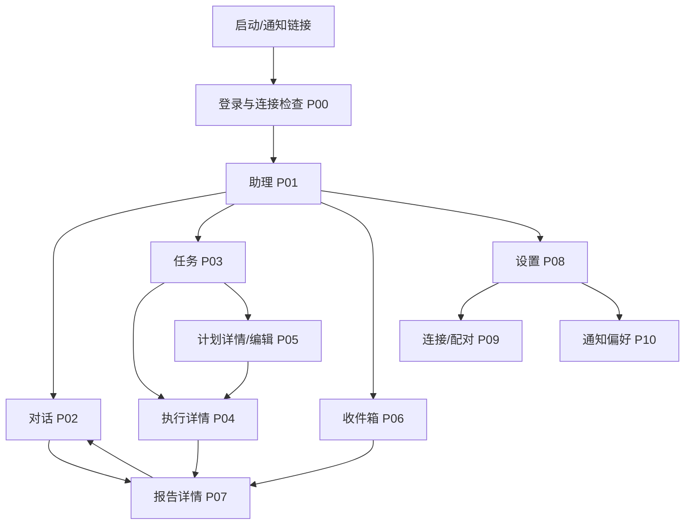

> 最新实施方向见 [08 手机指令与结果入口](08-mobile-command-center.md)：以助理、任务、我的为中心，允许精简。本页为历史设计记录。

# 01 信息架构

> **v0.2 更新（2026-10-14）**：本稿中的独立助理导航/演示架构已被“桌面完整功能的移动适配”替代。当前实施和功能清单以 [07 桌面功能对齐](07-desktop-parity.md) 为准。本文保留为初期设计记录；定时任务、远程连接和通知相关要求仍是后续增量设计，不代表已实现。

v0.1 · 2026-10-14 · 设计讨论稿。参见[总索引](README.md)。

## 产品承诺与边界

用户表达需求，SearchOS 执行，助理持续保存任务和交付结果。手机锁屏不会取消服务端执行；执行环境离线时不能承诺按时完成。通知是提醒，收件箱是可追溯的交付记录。

第一版：单用户、一个绑定执行环境、多个对话和任务；一次性搜索、一次/每日/每周计划；预算、来源等高级设置按需展开。搜索内容与来源选择沿用后端能力，不在本方案中限定业务领域。

后续：重要变化提醒、多执行端、多用户/共享、复杂日历规则、原生 App。第一版不提供任意终端命令或远程桌面控制。

## 导航结构

底部固定“助理 / 任务 / 收件箱”；详情页使用返回导航，返回时保留筛选与滚动位置。设置从顶部入口进入，不占底部导航。顶部连接提示不能遮挡输入。

## 页面与建议路由

| 编号 | 页面 | 路由建议 | 主要目标 |
| --- | --- | --- | --- |
| P00 | 启动/登录 | `/m/welcome` | 建立身份，保留原目标链接 |
| P01 | 助理首页 | `/m` | 开始需求，回到最近对话 |
| P02 | 对话 | `/m/conversations/:id` | 交办、追加要求、追问 |
| P03 | 任务列表 | `/m/tasks` | 切换“进行中/定时计划” |
| P04 | 执行详情 | `/m/runs/:id` | 进度、控制、结果 |
| P05 | 计划详情与编辑 | `/m/schedules/:id` | 频率、要求、历史、暂停 |
| P06 | 收件箱 | `/m/inbox` | 未读结果与需要处理的异常 |
| P07 | 报告 | `/m/reports/:id` | 阅读、来源、追问 |
| P08 | 设置 | `/m/settings` | 偏好、连接与通知入口 |
| P09 | 连接 SearchOS | `/m/settings/connection` | 配对、状态、撤销 |
| P10 | 通知设置 | `/m/settings/notifications` | 授权、预览、免打扰 |

路由是设计提议，尚未创建。报告通知使用稳定 report_id 链接；异常通知使用 run_id。链接不携带长期登录凭据。

## 业务对象

| 对象 | 含义 | 关系 |
| --- | --- | --- |
| Conversation | 用户可持续交流的对话 | 包含消息，关联多个任务/执行 |
| Task | 目标、来源、输出要求和预算 | 即时或长期；可有多个执行 |
| Schedule | 何时触发及补跑规则 | 第一版一个长期任务最多一个生效计划 |
| Run | 一次实际执行 | 固定使用任务与计划的某一版本 |
| Report | 某次执行的结果快照 | 可独立打开；后续追问不覆盖原报告 |
| Delivery | 交付及未读状态 | 报告或最终异常；可有多次通知尝试 |
| Device | 被绑定的执行环境 | 手机订阅属于用户，不等同于执行设备 |

同一报告从对话、任务和收件箱进入时内容一致。助理收件箱只包含交付物与最终异常，实时进度保留在对话/执行页。

## 信息优先级

1. 报告：结论与信息时间范围优先，其次正文和来源。
2. 执行：当前阶段、最新进展、耗时；没有可靠总量时不展示虚假百分比。
3. 计划：下一次时间、生效状态、目标；技术参数折叠。
4. 全局：服务连接、执行端状态分开，避免把“手机连上”当成“任务能执行”。

## 全局规则

- 默认时区建议 Asia/Shanghai；明确展示，修改设备时区不静默修改计划。
- 未绑定可查看引导；已登录且执行端离线时可查看助理服务中已保存的数据。
- 收藏/标签/高级文件浏览不作为第一版必要入口；后续按使用需求增加。
- 删除计划默认不删除历史结果；数据删除政策实施前确认。
