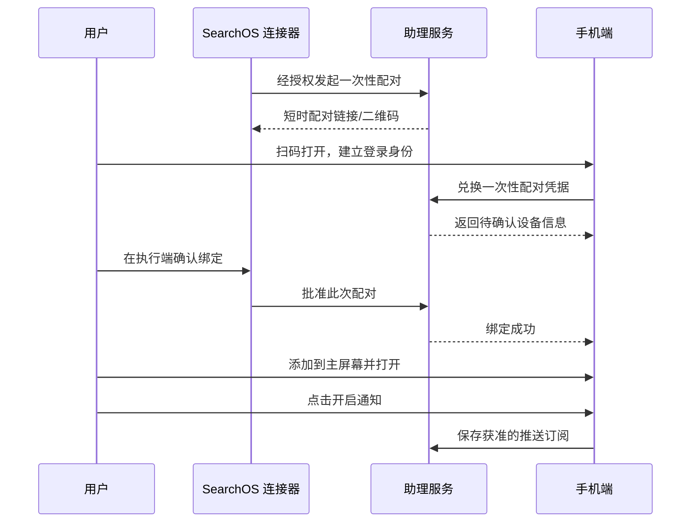
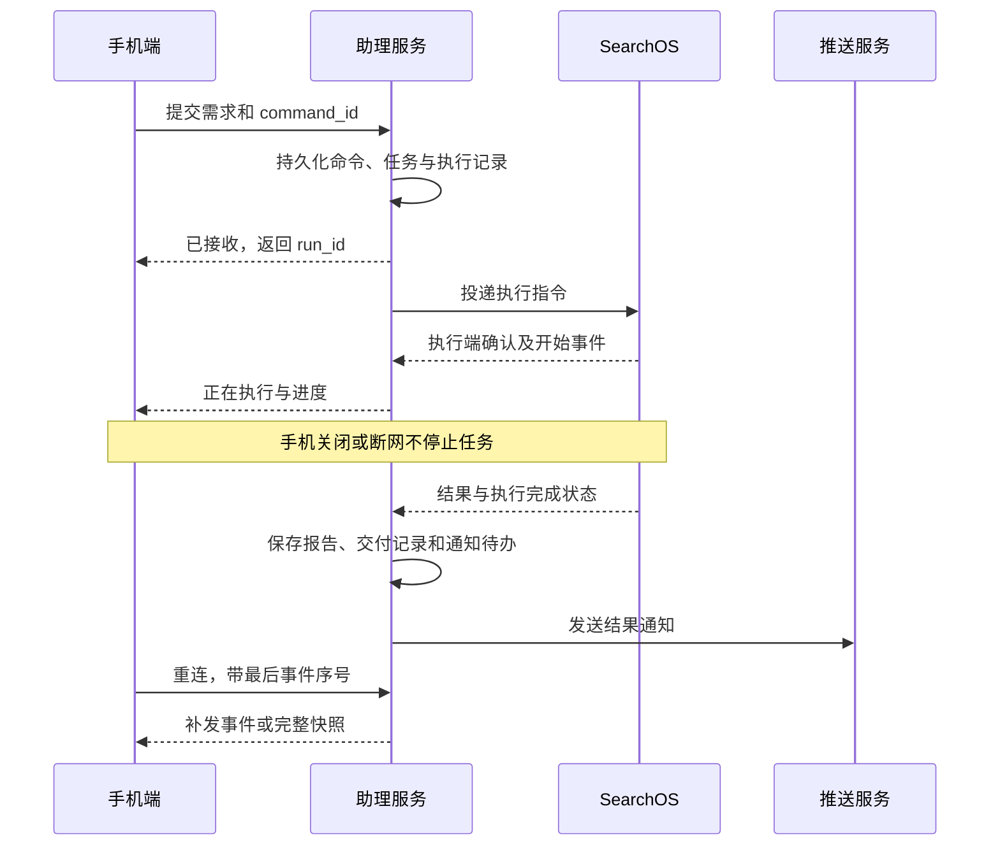
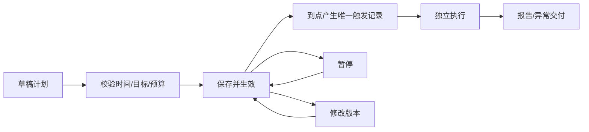

> 最新实施方向见 [08 手机指令与结果入口](08-mobile-command-center.md)：以助理、任务、我的为中心，允许精简。本页为历史设计记录。

# 03 交互流程

> **v0.2 更新（2026-10-14）**：本稿中的独立助理导航/演示架构已被“桌面完整功能的移动适配”替代。当前实施和功能清单以 [07 桌面功能对齐](07-desktop-parity.md) 为准。本文保留为初期设计记录；定时任务、远程连接和通知相关要求仍是后续增量设计，不代表已实现。

v0.1 · 2026-10-14 · 设计讨论稿。页面编号见 [01](01-information-architecture.md)，状态见 [04](04-states-and-errors.md)。

## F01 首次连接与通知启用

身份提供方待定；必须确保批准者有该执行端管理权限。配对凭据短时有效、单次兑换、限速；原始长期凭据不能写入二维码。刷新不重复绑定。拒绝/过期/撤销均不能继续兑换。

通知与绑定独立：跳过安装或拒绝通知仍能使用可用的搜索页面和收件箱。执行端已绑定时，不因通知授权失败重新配对。

## F02 即时搜索与重连

发送前已知执行端离线则不接受即时运行，保留草稿。接收后突然离线是另一种情况：显示已接收但尚未开始，在有限派发期限内重试，超时返回明确失败。响应丢失时使用原 command_id 查询/重试，不创建第二个任务。

第一版不声称整个分布式链路“恰好执行一次”：服务端去重、执行端持久化去重和恢复对账共同避免重复；执行状态不确定时先查询，不盲目重启搜索。

## F03 执行中追加与停止

追加要求：用户在运行中的 P02/P04 输入 → 确定目标 run_id → 提交独立 command_id → 服务端接收 → 执行端将要求交给当前运行 → 回显已接收。

追加要求的接收不承诺已经影响最终结果；可提供“等待执行端接收/已接收”。任务恰好结束时，返回状态冲突并提供“基于结果继续搜索”，不丢弃输入、不自动转成另一任务。

停止：点击停止 → 立即标记 stop_requested → 禁止重复点击 → 执行端停止成功后标记 cancelled。若先完成则保留 succeeded 和报告，显示“任务已完成”。停止不删除已产生的证据；部分结果只有可读时才提供并标明不完整。

## F04 创建与调整定时计划

1. 用户输入明确的定时需求，或点击“新建定时简报”。
2. 助理生成草稿卡：目标、范围、来源、输出要求、频率、时间、时区、预算、通知。
3. 缺少关键时间或目标时只补问必要项；无歧义的信息直接填好。
4. 用户保存/启用，服务端校验并显示下一次运行的完整时间。
5. 后续自然语言或表单编辑更新同一计划，回显变化。关键歧义才需要再次澄清。

例：“每天 9 点给我报告”不能默默解释成 9 点开始。若 D03 尚不支持交付时间模式，应明确当前仅支持开始时间并请用户选定，不虚构准时交付能力。

计划使用 IANA 时区，并保存 UTC 触发时间用于调度。每次运行固定 task_version 与 schedule_version，编辑不改写当前执行或过去报告。

## F05 定时执行与补跑

- 以 schedule_id + scheduled_for 建立唯一触发记录，重启或多个调度实例不能重复派发同一触发。
- 每期独立运行与报告；可参考上一期摘要，但不无限复用同一个可变搜索状态。
- 上次仍在运行时默认跳过本次并记录原因；用户手动“立即运行一次”也需检查并发策略。
- 执行环境离线时记录 missed；恢复后在补跑窗口内只补最近一期，其余标记 skipped。窗口数值 D04 待定。
- 如果任务要求增量简报，信息起点取上次成功覆盖截止时间；失败不推进截止时间。首次使用明确的初始回看范围，长期中断时显示实际覆盖范围与限制。
- 用户主动暂停期间不算漏跑，恢复后仅安排下一次；不自动补齐暂停期间的期次。
- 一次性计划执行结束后标记 completed；运行失败保留失败记录，重试创建新 attempt。

## F06 推送打开结果

报告保存成功 → 创建 Delivery → 写入通知待办 → 投递推送 → 用户点击 → 恢复身份 → 授权读取目标报告 → 渲染成功后标记已读。

推送 payload 默认仅携带通用标题、正文、稳定资源标识/站内链接；不含正文、密钥或具有永久访问能力的 URL。服务器接受推送不等于手机已展示，不等于用户已读。

异常分支：未登录先登录并保留目标；无权限显示访问失效；报告删除显示不可用及回收件箱入口；报告服务不可达显示重试。不能因为收到通知就绕过报告权限。

免打扰期间报告照常交付；待允许时将提醒合并，避免逐条轰炸。推送订阅失效则标记需重新开启通知，不重复重做搜索。

## F07 报告追问与长期任务修改

- “展开第二条”：携带 report_id 发起新执行，沿用对话关系，保存新报告。
- “以后都加入融资消息”：定位所属长期任务，修改未来计划要求并回显。
- “这个改成每周”：目标不唯一时展示候选，不猜测。
- 基于历史期次追问时使用该期报告快照；不能盲目将现有 follow_up_to 指到已变化的最新会话。

## F08 解除绑定和删除计划

解除绑定撤销该连接的访问凭据与相关推送投递资格；提示服务端计划不会自动暂停。保持/暂停计划必须是明确选择，不能把撤销访问误当作取消工作。

删除计划阻止未来触发，默认保留历史；有运行中任务时分别提供“仅删除计划”和“同时停止当前运行”。账户或全部数据删除属于 D05 后续确定的策略。
