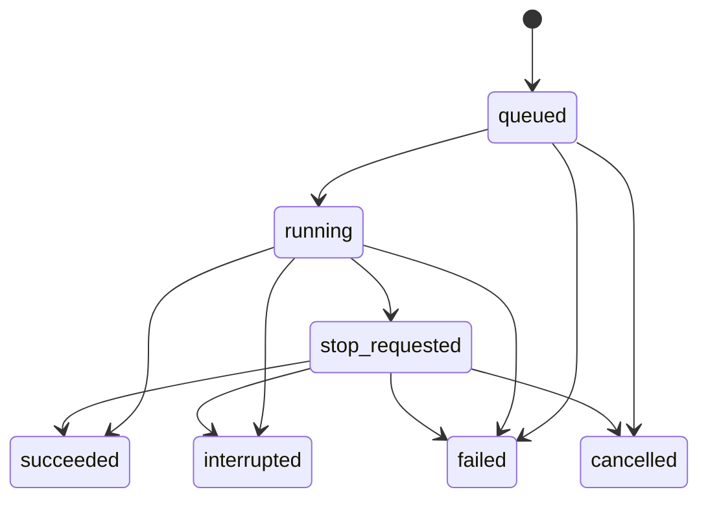

> 最新实施方向见 [08 手机指令与结果入口](08-mobile-command-center.md)：以助理、任务、我的为中心，允许精简。本页为历史设计记录。

# 04 状态与异常说明

> **v0.2 更新（2026-10-14）**：本稿中的独立助理导航/演示架构已被“桌面完整功能的移动适配”替代。当前实施和功能清单以 [07 桌面功能对齐](07-desktop-parity.md) 为准。本文保留为初期设计记录；定时任务、远程连接和通知相关要求仍是后续增量设计，不代表已实现。

v0.1 · 2026-10-14 · 设计讨论稿。本文件定义产品状态语义，非现有 SearchOS 枚举。

## 连接状态

手机网络、助理服务与执行端在线状态分别管理，不用一个绿色圆点代表全部正常。

| 状态 | 页面文案 | 可用操作 |
| --- | --- | --- |
| 未绑定 | 连接你的 SearchOS | 配对、查看引导 |
| 手机离线 | 网络已断开，正在等待连接 | 保留草稿；仅展示已在当前页面获取的内容 |
| 服务不可达 | 暂时无法连接服务 | 手动重试，不声称任务停止 |
| 身份失效 | 请重新登录以继续 | 登录后回原页面 |
| 执行端离线 | SearchOS 离线，最后在线于… | 查看服务已存数据，管理计划，禁止新即时运行 |
| 连接恢复中 | 正在同步最新进度 | 暂不基于陈旧状态执行控制 |
| 全部在线 | SearchOS 在线 | 正常操作 |
| 绑定已撤销 | 此设备的访问权限已撤销 | 清除本端会话，重新连接 |

第一版不承诺完整离线报告缓存。旧进度必须显示最后更新时间；运行中丢失心跳表示“状态待确认”，不能直接记作失败。

## 命令状态

`sending → accepted → acknowledged`；发送失败/超时显示可重试。accepted 指服务端持久化；acknowledged 指执行端接收。开始执行另由 Run 状态表达。

超时可能已被接收，先用 command_id 对账。相同 key 不同正文应拒绝；重试同正文返回原结果。派发超时的命令不得在执行端恢复后又偷偷开始，需校验过期时间。

## 执行状态

| 状态 | 含义与显示 |
| --- | --- |
| queued | 指令已持久化，等待执行；展示“已接收，等待开始” |
| running | 执行端确认正在工作；展示阶段、耗时和最近进展 |
| stop_requested | 已请求停止，尚未确认；按钮禁用，显示“正在停止” |
| succeeded | 搜索正常结束且结果已落地；允许质量标记 partial |
| failed | 已明确失败，不再自动继续；显示原因与可用恢复方式 |
| cancelled | 用户请求已导致停止；不等同于异常失败 |
| interrupted | 执行端确认原进程丢失且无法续跑；允许显式重试 |

网络瞬断不直接进入 interrupted；恢复后与执行端和产物对账。进程重启自动续跑不作第一版承诺。重试建立新 run/attempt 并关联原执行，不修改原历史。

报告完整度 `complete/partial` 与执行状态分开；数据源无新增时可正常成功，但必须说明检查范围，不能以空文本掩盖检索失败。用户取消或失败后可保存部分产物，不能标成完整成功。

## 计划及触发状态

计划：draft / active / paused / completed / deleted。deleted 是停止未来触发的逻辑状态；completed 用于已结束的一次性计划。

单次触发：pending / dispatched / missed / skipped。实际执行成败由关联 Run 表示。每个 missed 在恢复后补跑转 dispatched 或到期转 skipped；记录 reason，例如 offline、overlap、expired。

未来编辑增加版本；暂停与调度同时发生时以持久化生效顺序决定，本次已派发需单独停止。删除不级联删除报告是第一版建议，数据保留期限待定。

## 报告、已读和通知

- 报告：ready / unavailable；完整度独立；未落地前不能发“报告已生成”。
- Delivery：unread / read；加载内容成功才 read，重复打开幂等。
- 通知权限：not_requested / granted / denied / unsupported。
- 推送订阅：active / expired / revoked。
- 通知尝试：pending / submitted / retrying / failed / suppressed。submitted 仅表示推送服务接受请求，界面不能写“已送达手机”。

静音、免打扰、已读后无需提醒均可 suppressed，不影响 Delivery。默认按 delivery_id 去重提醒；通知失败不影响 Run 状态。

## 异常及文案

| 场景 | 提示 | 恢复行为 |
| --- | --- | --- |
| 配对过期 | 配对已过期，请重新生成 | 回到配对入口 |
| 发送响应丢失 | 正在确认是否已接收 | 先查命令，使用同 key 重试 |
| 无执行权限 | 你暂时无权控制此 SearchOS | 重新登录/联系实例管理员 |
| 预算耗尽 | 已达到本次运行上限 | 有部分报告则展示；明确新预算后续查 |
| 模型或来源服务不可用 | 搜索服务暂时不可用 | 展示可读原因；有限重试需遵守预算 |
| 执行端进程重启 | 本次执行已中断 | 保留历史，提供重新执行 |
| 正在停止时任务完成 | 任务已完成，可以查看报告 | 保留成功结果 |
| 追加时已结束 | 本次任务已结束 | 保留输入，提供继续搜索 |
| 目标交付时间已过 | 报告仍在生成，已延迟… | 保留进度，限制为一次延迟提醒 |
| 报告保存失败 | 结果正在保存，暂不可查看 | 重试保存，不重复搜索；不发完成通知 |
| 通知未授权 | 开启通知后可收到完成提醒 | 用户主动触发授权；收件箱正常使用 |
| 推送订阅失效 | 需要重新开启此设备的通知 | 引导重新订阅 |
| 通知目标被删除 | 这份报告已不可用 | 返回收件箱 |
| 执行端离线但报告已保存 | SearchOS 离线，历史报告仍可查看 | 从助理服务读取已同步报告 |

原始异常与调试堆栈只进入受控日志，不展示密钥和内部配置。

## 验收场景

| 编号 | 操作/条件 | 通过标准 |
| --- | --- | --- |
| A01 | iPhone 添加主屏幕并授权通知 | 能收到测试通知，点击定位指定页面 |
| A02 | 发起搜索后锁屏 | 服务端继续，返回页面状态正确 |
| A03 | 发送后响应丢失，重试 | 只有一个有效执行 |
| A04 | Wi-Fi/蜂窝切换 | 事件补齐，无重复消息或倒退状态 |
| A05 | 执行端离线 | 明确阻止新即时任务；历史仍可读取（服务在线） |
| A06 | 修改定时计划时已有运行 | 当前运行不变，下次用新版本 |
| A07 | 暂停计划跨过触发时间 | 不生成新执行；恢复不补暂停期 |
| A08 | 计划因离线错过多期 | 按补跑规则只补允许的一期，记录其余原因 |
| A09 | 推送服务拒绝请求 | 报告仍存在；通知单独重试 |
| A10 | 点击通知时登录已过期 | 登录后回到原报告并校验权限 |
| A11 | 停止与完成同时发生 | 最终状态一致，不丢已完成报告 |
| A12 | 追问旧期报告 | 引用该期快照，原报告不被覆盖 |
| A13 | 执行端崩溃重启 | 对账后显示真实状态，不静默重复收费执行 |
| A14 | 拒绝通知/免打扰 | 可完整使用收件箱，不反复索取权限 |
| A15 | 撤销绑定后使用旧凭据 | HTTP、事件流、文件读取均拒绝 |
| A16 | 新建一次/每日/每周计划 | 显示正确时区和下一次触发时间 |
| A17 | 同一触发被重复派发 | 执行端按持久化 key 去重 |
| A18 | 大字体/键盘打开/深色 | 主要操作可见，无整页横向溢出 |
