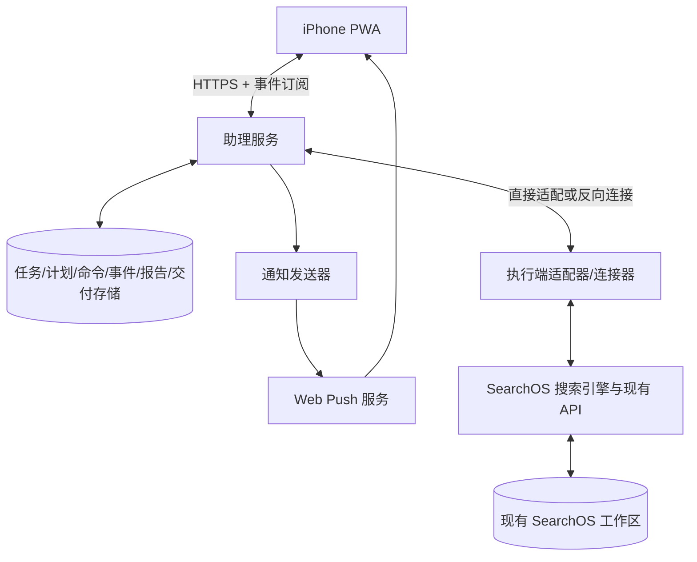

> 最新实施方向见 [08 手机指令与结果入口](08-mobile-command-center.md)：以助理、任务、我的为中心，允许精简。本页为历史设计记录。

# 05 服务边界与接口清单

> **v0.2 更新（2026-10-14）**：本稿中的独立助理导航/演示架构已被“桌面完整功能的移动适配”替代。当前实施和功能清单以 [07 桌面功能对齐](07-desktop-parity.md) 为准。本文保留为初期设计记录；定时任务、远程连接和通知相关要求仍是后续增量设计，不代表已实现。

v0.1 · 2026-10-14 · 架构讨论稿，建议接口均未实现。代码核对基线：`73cf9e5`。

## 服务边界

| 部件 | 负责 | 不负责 |
| --- | --- | --- |
| 手机端 | 页面、输入、进度显示、报告阅读、推送订阅 | 后台常驻搜索和定时调度 |
| 助理服务 | 身份、绑定、授权、指令持久化、计划、状态、结果交付 | 重写搜索策略 |
| 调度器 | 计算触发、去重、离线补跑和并发规则 | 让模型猜测当前应否触发 |
| 执行适配器 | 投递、持久化命令去重、回执、事件同步、恢复对账 | 向手机暴露任意本地服务 |
| SearchOS | 搜索、证据、报告、现有 follow-up/steer/stop 能力 | 手机身份与系统推送 |
| 通知发送器 | 订阅、投递、重试、免打扰与去重 | 重新运行失败通知对应的搜索 |

第一版建议为模块化单体，调度和执行生命周期与页面请求解耦；允许同机部署，无需提前拆成大量微服务。个人规模可评估 SQLite，部署多副本/多人后再评估数据库与队列升级。

## 两种连接部署

直接模式：手机经可达且授权的 HTTPS 入口访问助理服务，适配器在同机/受控网络访问 SearchOS。

中转模式：手机访问助理服务；执行端主动建立出站加密连接并认证，服务经该连接投递。无需直接暴露电脑入站端口，但仍是远程控制与数据传输通道。

两种模式复用手机 API。实施阶段确认公司允许的入口、域名、TLS、身份方式以及推送出站访问；不默认开公网、不默认安装个人隧道。

要在执行端离线时阅读历史，中转服务必须已持久化所需报告与摘要。是否同步附件、保存多久、能否同步特定内容必须可配置；仅转发而不保存的部署不能承诺离线阅读历史。

## 现有能力核对

| 已存在接口/模块 | 可复用能力 | 需要注意 |
| --- | --- | --- |
| `POST /api/search` | 创建搜索；query、effort、sources、follow_up_to 等 | 对话与每次 Run 需额外映射 |
| `POST /api/search/{session_id}/steer` | 追加要求 | 仅运行期间有效，处理状态竞争 |
| `POST /api/search/{session_id}/stop` | 停止执行 | 适配为明确 cancelled 语义 |
| `GET /api/search/{session_id}`、`/state` | 结果/状态 | 内存状态与持久化结果分别对账 |
| `GET /api/sessions` | 当前会话查询 | 不直接当作持久化任务仓库 |
| `WS /api/ws/{session_id}` | 现有实时事件流 | 需增加助理层持久化游标与重连协议 |
| `GET /api/history`、`/{session_id}` | 历史与多轮结果 | 映射不可变报告期次 |
| `POST /api/history/{session_id}/turns/{turn_index}/branch` | 历史分支 | 实施前验证用于旧期追问的完整语义 |
| `GET /api/workspace/{session_id}/files`、`/file` | 文件读取 | 手机侧只开放经过授权的报告资产 |
| `web/api/deps.py`、`routes/search.py` | 内存 sessions 与异步执行 | 不等同于进程重启恢复 |

现有后台索引/导入/主题摘要作业，以及 agent scheduler，不等同于用户可管理的每日/每周简报调度。当前抽查范围未发现本文完整的配对、Web Push 和用户定时简报能力；这不是对全仓库所有模块的审计。

参考路径：`web/api/routes/search.py`、`stream.py`、`history.py`、`workspace.py`、`web/api/main.py`。保持底层兼容，通过适配层新增能力。

## 建议数据模型

| 模型 | 主要字段 |
| --- | --- |
| User / DeviceBinding | owner_id、device_id、授权范围、撤销时间 |
| Conversation / Message | conversation_id、owner_id、正文、关联 task/run/report、时间 |
| Task | task_id、owner_id、conversation_id、目标、来源、输出要求、预算、version |
| Schedule | schedule_id、task_id、frequency、timezone、local_time、next_run_at、version、status、misfire_policy |
| Occurrence | schedule_id、scheduled_for、status、reason、run_id；唯一约束前两项 |
| Command | command_id、owner_id、device_id、type、payload_hash、expires_at、status、result_ref |
| Run | run_id、task_id、task_version、schedule_version、session_id、turn_ref、attempt、status、heartbeat_at |
| Event | run_id、seq、type、payload、created_at；唯一约束 run_id + seq |
| Report | report_id、run_id、正文快照、引用、信息时间范围、completeness、生成时间 |
| Delivery | delivery_id、owner_id、report_id 或 run_id、read_at |
| PushSubscription / NotificationAttempt | owner_id、订阅凭据、状态；delivery_id、尝试次数、结果 |

Task/Report 必须保留来源与内容范围信息；第一版不自行重定义 SearchOS 已有 sources 格式。真实推送订阅视为敏感凭据管理，不放日志或设计文件。

## 手机 API 建议

统一前缀 `/api/assistant/v1`，以下全部是待实现契约。

| 方法与资源 | 用途 | 返回/行为 |
| --- | --- | --- |
| `GET /me` | 当前身份 | 用户与有效权限 |
| `POST /pairings` | 已授权执行端发起配对 | 短时一次性凭据 |
| `POST /pairings/claim` | 手机申请兑换 | 待确认的 pairing_id、设备信息 |
| `POST /pairings/{id}/approve` | 执行端确认 | 原子创建绑定，凭据作废 |
| `GET /devices` | 设备与在线状态 | 最后心跳、能力 |
| `DELETE /bindings/{id}` | 撤销绑定 | 立即停止该授权访问与投递 |
| `GET/POST /conversations` | 查询/新建对话 | 分页列表或新 ID |
| `GET /conversations/{id}` | 消息与关联任务 | 分页、稳定消息 ID |
| `POST /conversations/{id}/messages` | 交办或追问 | command_id、消息、run_id 或计划草稿 |
| `GET /commands/{id}` | 发送超时后的对账 | 接收/执行端确认状态 |
| `GET /tasks`、`GET /tasks/{id}` | 任务列表与详情 | 目标、计划、运行关联 |
| `GET /runs`、`GET /runs/{id}` | 执行列表与状态 | 快照、最后 seq、结果引用 |
| `POST /runs/{id}/steer` | 追加要求 | 返回命令回执 |
| `POST /runs/{id}/stop` | 请求停止 | 异步回执，不冒充已停止 |
| `POST /runs/{id}/retry` | 显式重试 | 新 run_id，关联原执行 |
| `WS /events?run_id=…&after_seq=…` | 实时及补发事件 | 服务端重新校验访问权 |
| `GET/POST /schedules` | 查询/保存计划 | 版本、下次触发时间 |
| `GET/PATCH /schedules/{id}` | 读取/修改计划 | 版本冲突返回 409 |
| `POST /schedules/{id}/pause`、`/resume` | 暂停/恢复 | 新状态、下次时间 |
| `POST /schedules/{id}/run-now` | 立即运行一次 | 不移动常规计划 |
| `DELETE /schedules/{id}` | 删除未来计划 | 默认保留历史 |
| `GET /schedules/{id}/occurrences` | 历次触发/跳过记录 | 原因和 Run 引用 |
| `GET /reports/{id}` | 报告快照 | 内容、引用、完整度 |
| `GET /reports/{id}/assets/{asset_id}` | 授权资产读取 | 允许的资产类型，禁止任意路径 |
| `GET /inbox` | 交付列表 | 游标分页、未读数 |
| `PATCH /deliveries/{id}` | 已读状态 | 幂等更新 |
| `POST /inbox/read-all` | 批量已读 | 指定截止时间，避免吞掉并发新交付 |
| `GET /push/config` | 推送公开配置 | 仅公开订阅所需参数 |
| `POST /push/subscriptions` | 注册/更新订阅 | 与当前身份绑定 |
| `DELETE /push/subscriptions/{id}` | 取消订阅 | 撤销当前用户对应订阅 |
| `POST /push/test` | 用户主动测试 | 限速、通用内容 |
| `GET/PATCH /preferences` | 通知/免打扰/语言等 | 任务偏好可覆盖全局设置 |

认证登录/退出具体路由取决于 D02；不得直接暴露上述接口而省略身份实现。用户消息可生成计划草稿；计划生效走显式保存动作。需要复杂意图判断时使用模型解析结构化草稿，最终校验与调度由确定性代码完成。

## 通用协议规则

- 所有写命令带 command_id 或 Idempotency-Key，服务端以 owner + key 去重，执行端另做持久化去重；键复用但 payload 不同返回冲突。
- 通常异步接收返回 202，包含 command_id 和资源 ID；明确拒绝时不展示“已接收”。401 身份失效，403 无权，409 状态/版本冲突，422 输入不合法，429 限速，503 执行环境不可用。
- 列表使用游标分页；时间 API 返回 UTC 时间戳及业务时区；页面按计划时区展示计划。
- 事件至少包含 run_id、seq、type、created_at。事件可能重复，客户端按 ID 去重；游标过期返回 snapshot_required，先取快照和对应 seq，再补后续事件。
- WebSocket 通过同源安全会话或短时票据认证，不把长期 token 写 URL。采用 Cookie 时增加 CSRF 防护，并校验 WebSocket Origin。
- 绑定、报告、Run、文件和事件流均验证 owner 与设备授权；猜到 ID 不获得访问权。
- 每一期报告保存不可变快照；session_id/turn_ref 只是底层映射，不能用可变会话代替 report_id。

## 可靠性与通知

任务、触发记录、命令、事件持久化。报告与 Delivery/通知待办需事务性关联（例如 outbox），防止“已完成但没有交付记录”。推送失败只重试通知；搜索失败重试受到预算、幂等和执行状态约束。

执行连接器心跳建议作为可配置参数，不作为固定产品承诺。断线后执行端继续本地执行，结果写本地并在恢复后同步；服务端不能仅凭心跳丢失启动第二份搜索。需要可验证的运行身份、租约/版本和恢复对账。

已有每次文件轮询事件可作为适配数据源，第一版不必重写引擎事件系统；但增量读取、完整行处理、重连序号与终态同步要独立验收。

## 交付阶段与验收

1. 页面原型评审：导航、输入与状态完整，覆盖 P00–P10。
2. 即时闭环：绑定、搜索、回执、报告，满足 A02–A05、A10–A12、A15。
3. 定时闭环：计划持久化、独立期次、补跑与重启对账，满足 A06–A08、A13、A16–A17。
4. iPhone 通知与体验：安装、授权、推送、免打扰、深链接，满足 A01、A09、A14、A18。

这是建议开发顺序，不是本次已执行工作。具体部署、登录提供方、重试/预算数值及数据保留期限仍按总索引待定项维护。
